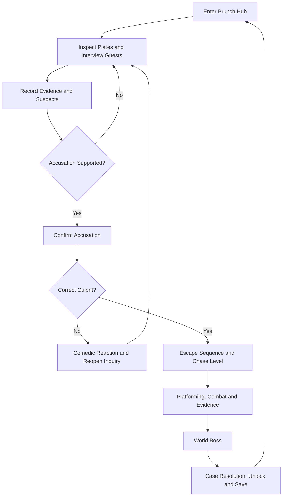

# Core Game Loop

## Case lifecycle

## Hub session

1. Select an available case from the board; inspect the related buffet station and speak to witnesses.
2. Discover world-unique clues and optional context clues; every clue has a clear inspectable hotspot, description and stable ID.
3. Compare clues with one or more suspects in the notebook. An accusation panel displays supporting evidence rather than a hidden correctness meter.
4. Correct accusations transition to escape/chase with case state preserved; incorrect accusations trigger authored responses, never arbitrary permanent lockout.

## Chase session

1. Enter from a named spawn point, optionally showing a level intro ticket.
2. Learn the signature hazard in isolation, then combine it with movement, enemies and optional rewards.
3. Pass checkpoints that capture checkpoint-local player state without prematurely completing the case.
4. Collect chase evidence; enter a boss arena with visual foreshadowing of the required counterplay.
5. Resolve the boss; mark case solved, bank rewards, save and transition back to the buffet.

## Failure and retry

- Hub: a wrong accusation preserves progress and encourages further investigation; authored dialogue is shown once or according to explicit repeat policy.
- Chase: defeat returns to checkpoint, restoring local state and temporary resources according to level settings, while preserving permanent unlocks.
- Boss: defeat returns to the designated pre-boss checkpoint; shortcuts, boss health reset and pickup refresh are explicitly configured.
- Saves: user-requested saving is rejected gracefully during non-serializable transitions; checkpoint autosave is permitted only after state is stable.

## Completion definition

A case is solved only when the culprit has been correctly identified, the chase boss has been defeated, and the case-resolution event has committed. A level's exit trigger is not sufficient by itself. See [Case system](03-investigation-and-cases.md), [Scene routing](16-game-flow-and-routing.md) and [Save schema](15-save-and-persistence.md).
