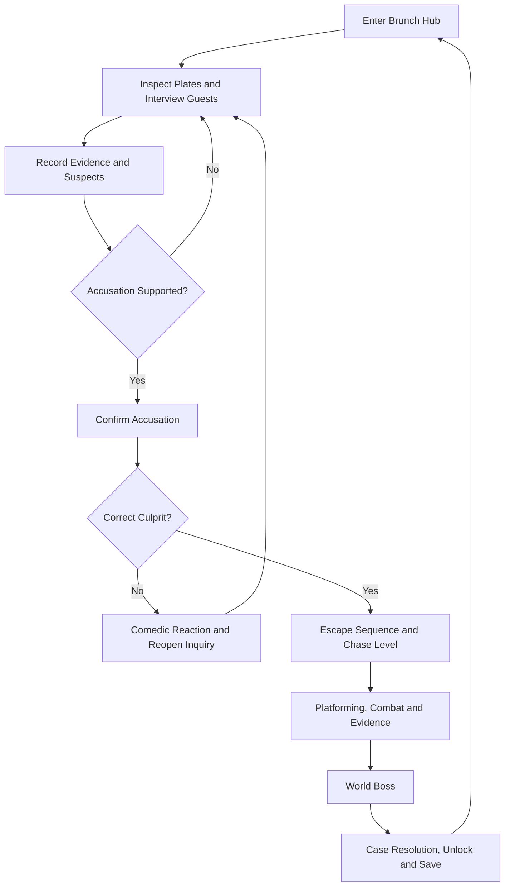

# Brunch Police — Complete Game Design & Technical Specification

**Official edition 1.0** · Godot 4 / GDScript · Eight worlds · Investigation, platforming, combat and campaign systems.

This consolidated edition contains the full game specification. The multi-file documentation package offers individual editable chapters and reference catalogs.

## Contents

- [Chapter 01 — Brunch Police — Master Documentation Index](#chapter-01---brunch-police---master-documentation-index)
- [Chapter 02 — Product Vision and Design Pillars](#chapter-02---product-vision-and-design-pillars)
- [Chapter 03 — Core Game Loop](#chapter-03---core-game-loop)
- [Chapter 04 — Investigation and Case Management](#chapter-04---investigation-and-case-management)
- [Chapter 05 — Dialogue and Narrative Events](#chapter-05---dialogue-and-narrative-events)
- [Chapter 06 — Interaction System](#chapter-06---interaction-system)
- [Chapter 07 — Player Movement, Traversal and Camera](#chapter-07---player-movement-traversal-and-camera)
- [Chapter 08 — Combat, Health, Damage and Feedback](#chapter-08---combat-health-damage-and-feedback)
- [Chapter 09 — Weapons and Equipment](#chapter-09---weapons-and-equipment)
- [Chapter 10 — Items, Pickups, Consumables and Status Effects](#chapter-10---items-pickups-consumables-and-status-effects)
- [Chapter 11 — Enemies and AI](#chapter-11---enemies-and-ai)
- [Chapter 12 — Culprits, Bosses and Arena Encounters](#chapter-12---culprits-bosses-and-arena-encounters)
- [Chapter 13 — World Structure and Campaign Progression](#chapter-13---world-structure-and-campaign-progression)
- [Chapter 14 — Quest, Objective and Evidence Tracking](#chapter-14---quest-objective-and-evidence-tracking)
- [Chapter 15 — UI, Menus and In-Game Information](#chapter-15---ui-menus-and-in-game-information)
- [Chapter 16 — Saving, Loading and Persistent Game State](#chapter-16---saving-loading-and-persistent-game-state)
- [Chapter 17 — Scene Flow, Routing and Transitions](#chapter-17---scene-flow-routing-and-transitions)
- [Chapter 18 — Godot Architecture and Portable Component Contracts](#chapter-18---godot-architecture-and-portable-component-contracts)
- [Chapter 19 — Controls and Accessibility](#chapter-19---controls-and-accessibility)
- [Chapter 20 — Visual Art Direction and Animation](#chapter-20---visual-art-direction-and-animation)
- [Chapter 21 — Audio Direction](#chapter-21---audio-direction)
- [Chapter 22 — Testing, QA and Acceptance](#chapter-22---testing-qa-and-acceptance)
- [Chapter 23 — Content Production Standards](#chapter-23---content-production-standards)
- [Chapter 24 — Narrative Voice, Representation and Localization](#chapter-24---narrative-voice-representation-and-localization)
- [Chapter 25 — Canonical Data Schemas and Stable Identifiers](#chapter-25---canonical-data-schemas-and-stable-identifiers)
- [Chapter 26 — Level Composition, Reusable Elements and Editor Workflow](#chapter-26---level-composition-reusable-elements-and-editor-workflow)
- [Chapter 27 — Production Milestones and Release Gates](#chapter-27---production-milestones-and-release-gates)
- [Chapter 28 — Glossary](#chapter-28---glossary)
- [Chapter 29 — Buffet Hub Navigation, Map and Minimap](#chapter-29---buffet-hub-navigation-map-and-minimap)
- [Chapter 30 — Events, Timers, Scoring and Scripted Sequences](#chapter-30---events-timers-scoring-and-scripted-sequences)
- [Chapter 31 — Optional Side Activities and Reusable Minigames](#chapter-31---optional-side-activities-and-reusable-minigames)
- [Chapter 32 — Checkpoints, Retries and Difficulty Policy](#chapter-32---checkpoints-retries-and-difficulty-policy)
- [Chapter 33 — World 01 — Grease Canyon](#chapter-33---world-01---grease-canyon)
- [Chapter 34 — World 02 — Pastry Palace](#chapter-34---world-02---pastry-palace)
- [Chapter 35 — World 03 — Sticky Syrup Swamp](#chapter-35---world-03---sticky-syrup-swamp)
- [Chapter 36 — World 04 — Kitchen Mayhem](#chapter-36---world-04---kitchen-mayhem)
- [Chapter 37 — World 05 — Caffeine Craze](#chapter-37---world-05---caffeine-craze)
- [Chapter 38 — World 06 — Egg Factory Frenzy](#chapter-38---world-06---egg-factory-frenzy)
- [Chapter 39 — World 07 — Citrus Cascade](#chapter-39---world-07---citrus-cascade)
- [Chapter 40 — World 08 — Bakery Bonanza](#chapter-40---world-08---bakery-bonanza)
- [Chapter 41 — Design Acceptance Matrix](#chapter-41---design-acceptance-matrix)
- [Chapter 42 — Enemy Roster — Behavior and Counterplay](#chapter-42---enemy-roster---behavior-and-counterplay)
- [Chapter 43 — Reusable Level Elements — Authoring Catalog](#chapter-43---reusable-level-elements---authoring-catalog)
- [Chapter 44 — Weapons — Visual and Gameplay Catalog](#chapter-44---weapons---visual-and-gameplay-catalog)


---

## Chapter 01 — Brunch Police — Master Documentation Index

> **Official game specification · Edition 1.0 · Godot 4 / GDScript**
>
> This index defines the authoritative game structure, names, level order, 
> system boundaries, and required integration contracts.  
> Specifications are authoritative design targets; 
> engineering completion is tracked separately by acceptance tests.

### Game identity

| Field                | Specification                                                                                                 |
| -------------------- | ------------------------------------------------------------------------------------------------------------- |
| Title                | **Brunch Police**                                                                                             |
| Genre                | Comic action-adventure, social investigation, and precision 2D platforming                                    |
| World structure      | Isometric/top-down buffet investigation hub → side-view chase level → boss → hub resolution                   |
| Engine and scripting | Godot 4.x, GDScript, scenes (`.tscn`) and reusable data resources (`.tres`)                                   |
| Core pillars         | Readable platforming, evidence-based accusations, food-themed combat, expressive encounters, reusable content |
| Tone                 | Whimsical, slapstick, readable, affirming; mischief rather than cruelty                                       |
| Art                  | Crisp pixel-art sprites, bold silhouettes, food-material color coding, receipt/clipboard UI                   |
| Saves                | Versioned, slot-based, cross-world game state; checkpoint-local respawn                                       |
| Naming               | Culprits use gender-neutral given names and singular they/them by default                                     |

### Eight worlds

| #   | World              | Culprit                         | Signature play                          | Design file |
| --- | ------------------ | ------------------------------- | --------------------------------------- | ----------- |
| 1   | Grease Canyon      | Bailey "Bacon Bandit" Brown     | Hot grease, ropes, bacon tornado        | World 01    |
| 2   | Pastry Palace      | Cameron "Croissant Crook" Cline | Mixers, frosting, pastry cover          | World 02    |
| 3   | Sticky Syrup Swamp | Skyler "Syrup Scoundrel" Sugars | Sticky surfaces, pancake rafts          | World 03    |
| 4   | Kitchen Mayhem     | Casey "Cutlery Thief" Canes     | Cutlery, falling pans, cover            | World 04    |
| 5   | Caffeine Craze     | Marlowe "Mocha Menace" Mugs     | Pressure-cycle steam and vertical lifts | World 05    |
| 6   | Egg Factory Frenzy | Morgan "Omelet Overlord" Eggman | Conveyors, egg machinery                | World 06    |
| 7   | Citrus Cascade     | Jordan "Juice Jacker" Squeeze   | Juice jets, slip, launchers             | World 07    |
| 8   | Bakery Bonanza     | Quinn "Muffin Mastermind" Munch | Ovens, flour, dough lifts               | World 08    |

### Design specifications

1. Product vision and game pillars
2. Core game loop
3. Investigation and cases
4. Dialogue and narrative events
5. Interaction system
6. Player, traversal, and camera
7. Combat, health, and feedback
8. Weapons and equipment
9. Items, pickups, and status effects
10. Enemies and AI
11. Bosses and encounters
12. World structure and progression
13. Quests, objectives, and evidence tracking
14. UI, menus, and HUD
15. Saving and persistence
16. Scene flow and transitions
17. Godot component contracts
18. Controls and accessibility
19. Visual identity and animation
20. Audio direction
21. Testing and acceptance
22. Content production standards
23. Narrative, representation, and localization
24. Data schemas and IDs
25. Level composition and tooling
26. Milestones and release gates
27. Terminology
28. Hub navigation and minimap
29. Events, timers and scoring
30. Side activities and minigames
31. Checkpoints, retries and difficulty

### Reference catalogs

- Reusable level elements
- Enemy behavior roster
- Weapon visual and behavior roster
- Design acceptance matrix

### Document conventions

**Rule:** a required gameplay contract or art constraint. **Default (tuning):** an editable starting value. **Content target:** designed but awaiting authoring or playtest approval. **Prototype:** a scene or script exists and must pass runtime QA. **Blocked:** a required integration does not yet have an accepted implementation.

Stable content IDs use snake_case. Display names are localized text and must never be used as save identifiers. Each gameplay feature specifies input, state change, output/feedback, and failure handling. No individual level may silently override a shared component's interface.


---

## Chapter 02 — Product Vision and Design Pillars

### High concept

The player is the self-appointed Brunch Police detective in an unruly buffet. The player observes diners, interviews witnesses, examines suspicious plates, assembles a case and makes an accusation. A correctly identified culprit flees into a food-themed side-scrolling world; the player pursues, overcomes enemies and environmental machines, captures additional evidence, wins a signature boss encounter, and closes the case back at the buffet.

### Intended audience and experience

Accessible character action with optional mastery for precise jumps, readable enemy telegraphs and entertaining detective deductions. Humor should arise from disproportionate food crimes and memorable personalities, not ridicule of identity. The environment and UI should teach mechanics before combining them.

### Pillars and tests

| Pillar                   | Player promise                                        | Design acceptance criterion                                                       |
| ------------------------ | ----------------------------------------------------- | --------------------------------------------------------------------------------- |
| Investigate, don't guess | Conclusions follow observable evidence                | A correct accusation is possible using in-world clues without prior knowledge     |
| Mechanical distinctness  | Each world teaches a signature traversal rule         | Signature mechanic appears in tutorial, escalation and boss encounter             |
| Readable action          | Every threat has a recognizable response              | Attack windup, hitbox and recovery can be distinguished in normal play            |
| Toy-box equipment        | Weapons change tactics and environmental interaction  | At least one weapon or item per world enables non-damage counterplay              |
| Portability              | The content library works in a second Godot game      | Copying addons and linking adapter contracts does not require hardcoded world IDs |
| Accessible presentation  | Interaction and danger do not rely on one sensory cue | Keyboard/gamepad focus, visible text, audio/visual warning pairs, reduced effects |

### Primary player verbs

Explore; inspect; interact; talk; collect; compare clues; accuse; move; jump; dash; climb/swing where allowed; aim; attack; charge; block; use item; activate machinery; save; review case notes.

### Boundaries

The hub is dialogue/investigation-led; chase levels emphasize authored obstacle courses; boss arenas remix world-specific mechanics. The game does not require random procedural levels. Difficult content must not require guessing the meaning of UI color alone. Enemy actions and hazards can reuse base behaviors but must read as unique to their setting.


---

## Chapter 03 — Core Game Loop

### Case lifecycle



### Hub session

1. Select an available case from the board; inspect the related buffet station and speak to witnesses.
2. Discover world-unique clues and optional context clues; every clue has a clear inspectable hotspot, description and stable ID.
3. Compare clues with one or more suspects in the notebook. An accusation panel displays supporting evidence rather than a hidden correctness meter.
4. Correct accusations transition to escape/chase with case state preserved; incorrect accusations trigger authored responses, never arbitrary permanent lockout.

### Chase session

1. Enter from a named spawn point, optionally showing a level intro ticket.
2. Learn the signature hazard in isolation, then combine it with movement, enemies and optional rewards.
3. Pass checkpoints that capture checkpoint-local player state without prematurely completing the case.
4. Collect chase evidence; enter a boss arena with visual foreshadowing of the required counterplay.
5. Resolve the boss; mark case solved, bank rewards, save and transition back to the buffet.

### Failure and retry

- Hub: a wrong accusation preserves progress and encourages further investigation; authored dialogue is shown once or according to explicit repeat policy.
- Chase: defeat returns to checkpoint, restoring local state and temporary resources according to level settings, while preserving permanent unlocks.
- Boss: defeat returns to the designated pre-boss checkpoint; shortcuts, boss health reset and pickup refresh are explicitly configured.
- Saves: user-requested saving is rejected gracefully during non-serializable transitions; checkpoint autosave is permitted only after state is stable.

### Completion definition

A case is solved only when the culprit has been correctly identified, the chase boss has been defeated, and the case-resolution event has committed. A level's exit trigger is not sufficient by itself. See Case system, Scene routing and Save schema.


---

## Chapter 04 — Investigation and Case Management

### Player goal

Identify the culprit through inspectable clues, character interviews, plate examinations and an explicit accusation. The game provides enough in-world information for a reasoned deduction and celebrates correct reasoning without punishing experimentation harshly.

### Model

- **CaseDefinition:** `case_id`, title, buffet station, involved suspects, clue IDs, minimum accusation criteria, culprit ID, chase level ID, rewards and completion event.
- **SuspectDefinition:** `suspect_id`, display name, role, portrait, dialogue graph, alibi, visible behavior cues and optional red-herring clues.
- **EvidenceDefinition:** `evidence_id`, `case_id`, name, inspectable world object ID, description, type, display icon, related suspect IDs, discovered state and journal text.
- **CaseState:** `discovered_evidence_ids`, interviewed NPC IDs, unlocked accusations, attempted accusation IDs, `case_status`, boss defeated and resolution committed.
- **EvidenceRelation:** optional explicit links (`supports`, `contradicts`, `context`) between evidence and suspect claims.

### Investigation spaces

The buffet hub contains food stations, tables, seating, drink counters, staff doors and an investigation board. Evidence can be concealed in plate close-ups, receipts, shelf displays, spilled ingredients, inventory items and NPC dialogue. Evidence is discoverable by inspection, not automatic proximity alone unless accessibility settings enable simplified interaction.

### Plate inspection flow

1. Focus on an interactable plate to open an inspection overlay; suspend movement and preserve input focus origin.
2. Pan/select hotspots with cursor or focus controls; hotspots include affordance outlines and text labels.
3. Inspect a hotspot to reveal description, significance, and optionally a new evidence ID.
4. Show discovered/total inspectable clues without exposing unseen answers.
5. Close inspection, restore focus and update case notebook/HUD objective.

### Accusation flow

1. Select suspect; show suspect profile and relevant evidence tiles.
2. The player explicitly selects the supporting evidence or confirms the evidence summary.
3. Validate the case's required clue predicates. If insufficient, provide an actionable explanation without exposing concealed evidence.
4. Submit. If suspect is incorrect, display unique dialogue and record attempt; the case stays open.
5. If correct, commit `accusation_correct`, play escape sequence, set `case_status = chase_active` and route to the target chase scene.

### Evidence plan by world

| World              | Primary exhibit       | Hub evidence example                             | Chase corroboration                         |
| ------------------ | --------------------- | ------------------------------------------------ | ------------------------------------------- |
| Grease Canyon      | Bacon strips          | Unusual bacon stack and grease trail             | Stolen bacon scattered along chase          |
| Pastry Palace      | Croissant wrapping    | Crumb-lined carry bag and missing pastry receipt | Marked pastry wrappers near escape route    |
| Sticky Syrup Swamp | Syrup valve seal      | Sticky spill and tampered dispenser              | Matching valve key imprint                  |
| Kitchen Mayhem     | Stolen cutlery        | Empty cutlery tray and utensil count             | Initialed cutlery cache                     |
| Caffeine Craze     | Stolen coffee tags    | Empty carafes, decaf swap, oversized travel mug  | Missing carafe labels on espresso equipment |
| Egg Factory Frenzy | Egg-carton manifest   | Egg count mismatch and shipping labels           | Factory carton seals                        |
| Citrus Cascade     | Bottle security seals | Empty orange juice rack and tampered caps        | Matching juice bottling batch tags          |
| Bakery Bonanza     | Muffin wrapper stamp  | Muffin display shortfall and flour trail         | Wrapped muffin cache in boss area           |

**Content target:** each world must contain a minimum of one identity clue, one location/means clue and one corroborating clue. The examples above establish level-writing targets; final clue dialogue and hotspot placement require authored scene content.

### Edge cases and acceptance

- Evidence acquired in a chase must remain associated with its case when returning to the hub.
- A wrong accusation cannot start the chase or overwrite a solved case.
- Duplicate evidence pickups do not create multiple IDs or inflate counters.
- Save/load during a case restores discovered clues, attempts and tracked case accurately.
- Dialogue/inspection from one case cannot complete another without explicit shared-evidence rules.


---

## Chapter 05 — Dialogue and Narrative Events

### Dialogue requirements

NPC dialogue displays speaker name and optional portrait, supports a typewriter reveal, player response choices, conditional branches, localized strings and event emission. The dialogue panel respects accessibility text speed and reduced-motion settings. A single input reveals the current line; a subsequent input advances it.

### Data contract

`DialogueConversation` contains `conversation_id`, `start_node_id` and nodes. Each `DialogueNode` has `node_id`, `speaker_id`, text localization key, optional portrait expression, optional on-enter/on-exit event IDs and a list of choices. Each choice has text key, predicate IDs, next node ID and optional event IDs. Conditions are evaluated against read-only case/quest state.

### Narrative events

`evidence_discovered(evidence_id)`, `npc_interviewed(npc_id)`, `quest_advanced(quest_id, objective_id)`, `accusation_submitted(case_id, suspect_id)`, `culprit_exposed(case_id)`, `chase_started(level_id)` and `case_closed(case_id)` are semantic events. They carry stable IDs, never display names.

### Dialogue behavior rules

- Every required clue must be obtainable even if optional conversation branches are skipped.
- Choices that trigger accusation or scene transitions require a confirmation boundary.
- Suspects and witnesses use their specified names/pronouns; no dialogue infers identity from visual presentation.
- On pause, dialogue state is retained; scene changes close the panel and serialize relevant narrative flags.
- Keyboard, gamepad and mouse paths must reach the same choices. Focus returns to the original interactable after closing.

### Writing standard

Comedic beats should be concise and clue-bearing. Dialogue may redirect the player but must not obscure an essential fact behind timing, audio-only speech or unskippable long text. Plan a neutral fallback line for repeated interrogation.


---

## Chapter 06 — Interaction System

### Contract

Every interactable advertises an action label, required context and enabled state. A centralized `InteractionController` selects the best candidate within detection range and emits an interaction request. Individual scenes own the actual effects.

| Property           | Meaning                                                     |
| ------------------ | ----------------------------------------------------------- |
| `interaction_id`   | Stable ID scoped to scene or game                           |
| `verb_key`         | Localized verb: Talk, Inspect, Open, Use, Activate, Collect |
| `priority`         | Tie-breaker when multiple items overlap                     |
| `activation_range` | Reach distance or interaction area                          |
| `requires_flags`   | Quest/case predicates                                       |
| `interact()`       | Invokes behavior, returns accepted/rejected result          |

### Standard interactables

NPC conversations, plate inspection, readable case board, evidence, switch/valve, door/exit, checkpoint, weapon pickup, and boss trigger. Interactive level machinery may have `enable()`, `disable()` and `activate()` endpoints if exposed through adapters.

### Input and feedback

Show a bottom-corner prompt with resolved binding (e.g. `E — Inspect plate`). Hidden/disabled objects do not steal focus; inaccessible interactions explain missing requirements. Trigger once per input press; long-press interactions display progress with a cancel option. Prompt disappears during blocking dialogue, inspection or cutscene.

### Engineering rules

- Interaction zones may be `Area2D`; selecting an eligible target is deterministic.
- Use signals or command dispatch rather than child nodes directly referencing global UI paths.
- Routing to other scenes goes through `SceneRouter`; actors never `change_scene_to_file()` arbitrarily.
- Every interaction is idempotent or guarded against duplicate activation, particularly evidence and rewards.


---

## Chapter 07 — Player Movement, Traversal and Camera

### Two movement modes

**Hub controller:** top-down/isometric walk, facing direction, NPC interaction, inspection and evidence collection. **Chase controller:** `CharacterBody2D` with horizontal acceleration, controlled deceleration, gravity, variable-height jump, coyote time, input buffering, fast-fall, optional double jump, wall jump, dash and rope traversal. The controllers share inventory, health and narrative state but not their movement implementation.

### Platformer controller settings

| Export field          | Intended behavior              | Starting value (tuning) |
| --------------------- | ------------------------------ | ----------------------- |
| `run_speed`           | Maximum horizontal speed       | 225 px/s                |
| `accel` / `decel`     | Ground response                | 1400 / 1600 px/s²       |
| `gravity`             | Downward acceleration          | 1100 px/s²              |
| `jump_velocity`       | First upward impulse           | -390 px/s               |
| `coyote_time`         | Jump grace after leaving ledge | 0.10 s                  |
| `jump_buffer_time`    | Jump shortly before landing    | 0.12 s                  |
| `jump_cut_multiplier` | Short hop on release           | 0.5                     |
| `dash_duration`       | Sustained dash state           | 0.17 s                  |
| `dash_cooldown`       | Time before another dash       | 0.65 s                  |

These are editable prototyping defaults, not final balance. For 2D physics, preserve constant gravity acceleration and let `move_and_slide()` resolve surfaces; grounded velocity is clamped to zero as necessary rather than disabling the entire gravity model globally.

### Update order

1. Read input actions and accessibility remapping.
2. Update timers/buffers, status multipliers and available movement actions.
3. Handle dash/rope overrides or ground/air control.
4. Resolve gravity, jump, fast-fall and moving-platform velocity.
5. Call `move_and_slide()` exactly once per physics tick.
6. Update facing, animation state and camera targets.

### Specialized traversal

- **Swing rope:** explicit grab/release interface; conserve release momentum; ignore repeated grab input while attached.
- **Conveyors:** apply surface transfer speed without teleporting the player; clamp at edges.
- **Steam lift:** upward push is clearly distinct from horizontal damaging steam, both governed by pressure phase.
- **Slippery/sticky surfaces:** surface modifiers modify acceleration and traction; status controllers combine effects through predictable precedence.
- **Collapsing/sinking platforms:** warn, trigger when occupied, reset after delay or checkpoint reload.

### Camera

Camera2D smooth follow with constrained lookahead, dead zones and bounded zoom. Allow camera volumes for vertical climbs, boss arenas and cutscenes; never reveal large dead zones or off-level art. Camera shake and flash can be reduced or disabled independently.

### Death and checkpoints

Checkpoint data stores `level_id`, `checkpoint_id`, position, facing and allowed transient state. Respawn clears incapacitating states and active projectiles; permanent evidence/unlocks remain. Fall recovery never places the player inside an active crusher or damage volume.


---

## Chapter 08 — Combat, Health, Damage and Feedback

### Combat model

A hit is a structured payload processed by a receiver. Weapons, enemies and hazards share the same receiver contract; differences are expressed with tags and policies. The receiver is responsible for armor/vulnerability gating, damage adjustment, immunity, applied statuses and event feedback.

```text
Attack → collision candidate → faction/filter validation
       → invulnerability and block test → armor/weak-point rules
       → damage modifiers → health change → status application
       → knockback/interruption → VFX/audio/UI feedback
```

### Required combat payload

`attacker_id`, `faction`, `base_damage`, `damage_tags`, `hit_position`, `hit_direction`, `knockback`, `status_effects`, `crit_flag`, `attack_instance_id`. The receiver returns a result including `accepted`, `blocked`, `damage_applied`, `statuses_applied`, `interrupted` and `death_triggered`. Attack instance IDs prevent a multi-frame melee hitbox from striking the same entity unintentionally more than once.

### Health rules

- Health is bounded to `[0, max_health]`; reaching zero emits `died` once before actor-specific cleanup.
- Damage, healing and max-health changes emit signals for HUD and sound; health nodes never assume the owner should immediately disappear.
- Player invincibility frames prevent repeated damage for a configured interval; environmental kills and scripted boss conditions may explicitly bypass this only by policy.
- Enemy death can trigger drops, score and encounters; a boss death commits only after death animation and completion transaction.

### Armor, guard and weakness

`ResistanceProfile` evaluates tags such as `sharp`, `blunt`, `heat`, `cold`, `sticky`, `projectile` and level-specific `shell_break`. Shields evaluate hit direction and durability before HP damage. A boss may stay armored until a specific counter (e.g. Egg Launcher shell crack or Caffeine pressure valves) opens an explicit vulnerability window. A status immunity must be distinguished from zero damage resistance.

### Effects and visuals

`CombatFeedback` listens to hit/blocked/status/died events and drives `AnimationPlayer`, VFX scenes, particles, hit flashes, audio and camera cues. Accessibility limits flash frequency and camera shake. Event feedback does not alter the gameplay damage state.

### Enemy attack readability

Every attack defines telegraph → active frames → recovery and cancellation windows. Counterplay must be possible at ordinary movement speed and supported by silhouette, sound and placement. Record actual active frames, hitbox size and cooldown during animation authoring.

### Verification

Test friendly-fire policy, repeated hits, immunity, guard angles, resistances, status stacking, simultaneous death/hit, offscreen projectiles and boss-phase damage gates. Maintain deterministic hit order for replayable tests.


---

## Chapter 09 — Weapons and Equipment

### Slots and actions

The player has `main_hand`, `off_hand` and `two_hand` slots. Equipping a two-handed weapon occupies both hands; unequipping restores legal inventory state, not an untracked hidden item. Each weapon may provide **quick**, **charged**, and **special** actions; unsupported actions are visibly disabled. Shields use guard/parry actions; throwables and utility items have explicit uses and stack counts.

### Definition structure

`WeaponDefinition` contains: `weapon_id`, name/localization key, category, allowed slots, icon/sprite, action definitions, equip restrictions, optional ammo type, VFX profile and tags. `AttackDefinition` includes attack kind (melee/projectile/field/guard), damage, range, active duration, cooldown, charge time, input mode, projectile/field resource, status payload, knockback and feedback. Numeric fields are Inspector-tunable.

### Reusable archetypes

| Archetype       | Base implementation                         | Examples                                                           |
| --------------- | ------------------------------------------- | ------------------------------------------------------------------ |
| Light melee     | Short-lived active hitbox, lunge optional   | Brunch Fork, Croissant Cutter, Espresso Stirrer                    |
| Heavy melee     | Windup, wide cleave or ground shockwave     | Baguette Maul, Tamper Hammer, Frying Pan                           |
| Ranged launcher | Projectile scene + lifetime, hit policy     | Bacon Gun, Whipped Cream Cannon, Egg Launcher, Portafilter Blaster |
| Shield          | Guard arc, durability, block event          | Extra Bacon Shield, Hot Lid, Coffee Filter Shield                  |
| Throwable       | Arc or target landing → impact/field        | Jam Jar Grenade, Yolk Bomb, Bean Bomb                              |
| Utility/trap    | Persistent area or temporary actor modifier | Sticky Net, Pepper Grinder, Grease Slide                           |

### Core weapons and world loadouts

**Global:** Brunch Fork is the baseline. Bacon Gun is a signature control launcher; a campaign availability decision is tracked as a balancing/content task, not baked into behavior.

| World              | Main-hand               | Off-hand             | Two-handed            | World-special / reward                         |
| ------------------ | ----------------------- | -------------------- | --------------------- | ---------------------------------------------- |
| Grease Canyon      | Bacon Gun / Brunch Fork | Extra Bacon          | Optional heavy unlock | Grease Slide / bacon control                   |
| Pastry Palace      | Croissant Cutter        | Whipped Cream Shield | Baguette Maul         | Bread Slicer / Whipped Cream Cannon            |
| Sticky Syrup Swamp | Butter Knife            | Sticky Net           | Syrup Cannon          | Butter Knife pickup / Syrup Launcher           |
| Kitchen Mayhem     | Chef's Cleaver          | Hot Lid              | Rolling Pin Roller    | Dishwasher Sprayer / Rolling Pin               |
| Caffeine Craze     | Espresso Stirrer        | Coffee Filter Shield | Portafilter Blaster   | Tamper Hammer / Bean Bomb                      |
| Egg Factory Frenzy | Egg Beater              | Yolk Bomb            | Frying Pan            | Egg Whisk / Egg Launcher                       |
| Citrus Cascade     | Orange Zester           | Juice Squeezer       | Citrus Blaster        | Zester Shooter / Citrus Blaster reward variant |
| Bakery Bonanza     | Dough Cutter            | Flour Puff           | Bread Roller          | Dough Roller / Flour Blaster                   |

Additional variants and visual hooks are in the weapon roster.

### Rules

- `weapon_id` is stable; display name and image can be changed without breaking saves.
- Runtime projectiles derive ownership/faction from their spawner and never from a sprite filename.
- Charge timers, ammo, cooldowns and item counts cannot become negative.
- Attack animation effects are events; they do not independently apply damage unless explicitly defined as hitbox activators.
- Every weapon receives one interactive test and one combat contract test against an ordinary enemy, an immune enemy and an armored boss.


---

## Chapter 10 — Items, Pickups, Consumables and Status Effects

### Item roles

`ItemDefinition` separates stable identity from presentation and use behavior. Classes include collectible evidence (case-scoped, non-consumable), permanent equipment, stackable consumable, temporary power-up, ammo and key/utility object. World pickups display icon and quantity, emit pickup feedback and remove themselves only after successful inventory admission.

### Power-ups

| World              | Power-up                                 | Gameplay purpose                                |
| ------------------ | ---------------------------------------- | ----------------------------------------------- |
| Grease Canyon      | Grease Slide; Extra Bacon                | Evasion/trail slow; one-hit absorb              |
| Pastry Palace      | Syrup Trail; Whipped Cream Shield        | Area slowdown; damage absorb                    |
| Sticky Syrup Swamp | Butter Boots; Honey Comb                 | Traction protection; bee distraction            |
| Kitchen Mayhem     | Dish Soap Speed Boost; Shield of Cutlery | Temporary speed; projectile reflection          |
| Caffeine Craze     | Caffeine Rush; Foam Barrier              | Temporary movement/attack haste; one-hit shield |
| Egg Factory Frenzy | Omelet Shield; Egg Timer                 | Absorb a hit; temporary enemy slow              |
| Citrus Cascade     | Vitamin Boost; Citrus Blast              | Heal; sticky explosive pulp                     |
| Bakery Bonanza     | Oven Mitts; Muffin Shield                | Heat protection; projectile absorb              |

### Effect library

| Effect tag | Semantics                         | Stacking baseline                    |
| ---------- | --------------------------------- | ------------------------------------ |
| `slow`     | Reduces movement speed            | Strongest strength, refresh duration |
| `haste`    | Improves movement/attack timing   | Refresh duration, capped multiplier  |
| `stun`     | Suppresses movement/attack        | Short duration, diminishing refresh  |
| `wrapped`  | Holds movement, may allow damage  | Single instance with refresh cap     |
| `freeze`   | Full movement lock                | Boss-specific immunity policy        |
| `blind`    | Reduces aim accuracy or detection | Refresh; visual accessibility alt    |
| `burn`     | Periodic damage                   | Refresh with bounded tick count      |
| `slippery` | Changes traction/turning          | Applied from surfaces or items       |
| `shielded` | Absorbs allowed hits              | Finite charges; no infinite refills  |

### Temporal rules

Status effect records include `effect_id`, potency, duration, time basis, origin attack ID, stacking policy and immunity tags. Permanent pickups are never serialized as active transient statuses. Pause freezes gameplay timers; menu UI timers can continue when permitted. Clearing a state emits an `effect_removed` signal so UI/VFX can reliably disappear.

### Evidence

Evidence IDs are owned by the case system, not stackable inventory quantities. A collectible may trigger an item notification and journal update, but the authoritative discovered flag belongs to `CaseState`. See Investigation.


---

## Chapter 11 — Enemies and AI

### Reusable controller model

Regular actors consist of a scene, `EnemyDefinition` resource, movement strategy, targeting/attack strategy, health/hit receiver, status component and feedback component. Distinguish **behavior state** (`idle`, `patrol`, `chase`, `attack`, `recover`, `retreat`, `flee`) from **combat overlays** (`stunned`, `frozen`, `wrapped`, `slowed`, `blinded`, `invincible`). An overlay modifies or interrupts a behavior state but does not erase its original objective.

### Enemy schema

`enemy_id`, display name key, world tags, archetype, max HP, speed, contact damage, detection distance, preferred attack distance, cooldown, movement/attack strategy IDs, status resistances, drops, score and VFX profile.

### Behavioral families

Ground patrol, charge/swoop, hopper, lane roller, flying patrol, flying bomber, ranged sentry, turret, summoned minion, armored guard and environment-bound hazard. Reuse these families for food variants rather than branching on enemy names. Enemies are platform-edge aware unless a deliberate attack overrides this limit.

### World roster

| World              | Primary enemies                                                           | Learning focus                                     |
| ------------------ | ------------------------------------------------------------------------- | -------------------------------------------------- |
| Grease Canyon      | Small Angry Pigs; Bacon Worms; Flying Sausage Links                       | Charge timing, rope hazards, swoops                |
| Pastry Palace      | Flying Éclairs; Rolling Baguette; Jelly-Filled Donuts; Rolling Croissants | Ranged arcs, rolling lanes, exploding pursuers     |
| Sticky Syrup Swamp | Angry Bees; Syrup Golems; Flying Butter Pats                              | Combat under sticky movement constraints           |
| Kitchen Mayhem     | Knife-Throwing Chefs; Dishwashing Sponges; Spinning Ladles                | Cover, hopping pressure, stationary blades         |
| Caffeine Craze     | Bean Bouncers; Grinder Gremlins; Froth Flyers                             | Accelerating hops, armored shots, airborne control |
| Egg Factory Frenzy | Angry Chickens; Eggshell Drones; Frying Pans; Cracked Egg Creatures       | Conveyors, bombing, shell hatching                 |
| Citrus Cascade     | Squeezing Machines; Lemon Bats; Orange Peel Traps                         | Pushback jets, swoops and rolling hazards          |
| Bakery Bonanza     | Flour Bag Monsters; Rolling Muffin Trays; Burning Muffins                 | Visibility, lane control and fast charges          |

See the full enemy roster for role, contact behavior, counterplay and environmental relationships.

### Encounter constraints

Every enemy must show direction and actionable telegraph before a punishing attack. Spawners cap concurrency, clean up on level unload, and provide authored minimum safe spacing around player spawn/checkpoint. Pause and dialogue freeze movement/attacks; offscreen despawn may never invalidate a required quest objective.


---

## Chapter 12 — Culprits, Bosses and Arena Encounters

### Canonical culprits

| World              | Culprit                         | Crime                               | Core counterplay                                         |
| ------------------ | ------------------------------- | ----------------------------------- | -------------------------------------------------------- |
| Grease Canyon      | Bailey "Bacon Bandit" Brown     | Takes an entire plate of bacon      | Dodge Bacon Tornado; punish slowdown using Bacon Gun     |
| Pastry Palace      | Cameron "Croissant Crook" Cline | Conceals stolen croissants          | Avoid sticky thrown croissants; punish throw recovery    |
| Sticky Syrup Swamp | Skyler "Syrup Scoundrel" Sugars | Dumps syrup across buffet food      | Avoid cannon-covered zones; punish reload                |
| Kitchen Mayhem     | Casey "Cutlery Thief" Canes     | Steals forks, spoons and knives     | Destroy dish cover; evade projectiles                    |
| Caffeine Craze     | Marlowe "Mocha Menace" Mugs     | Hoards coffee, sabotages dispensers | Redirect steam, overheat machine, strike exposed cockpit |
| Egg Factory Frenzy | Morgan "Omelet Overlord" Eggman | Takes all eggs for a giant omelet   | Avoid spatula flips; use Egg Launcher to crack guard     |
| Citrus Cascade     | Jordan "Juice Jacker" Squeeze   | Steals orange juice                 | Dodge juice streams; punish reload                       |
| Bakery Bonanza     | Quinn "Muffin Mastermind" Munch | Hides stolen muffins                | Break tray cover; dodge explosive muffins                |

All culprits use **they/them** pronouns in game text unless a distinct character profile explicitly specifies otherwise.

### Boss components

`BossCore` owns health thresholds, invulnerability policies, current phase, phase-change signals, exposed windows and defeat transaction; a boss controller owns spatial patterns and authored choreography. `EncounterController` activates hazards, waves and cutscenes. Bosses must not inherit generic enemy behavior assumptions such as patrolling off platforms.

### Phase design template

Every phase must describe entry condition, attack rotation, telegraph animation, recovery windows, active environmental machines, weapon interaction, safe-zone layout, phase-exit event and difficulty escalation. Vulnerability windows emit start/end events and show an unmistakable visual plus audio cue.

### Common arena flow

Intro (safe player position) → teach one pattern → patterned attacks → counter interaction → vulnerability → damage opportunity → next phase or final defeat. A boss defeat is committed exactly once, after animation and rewards, and triggers case resolution. Failing the boss routes to its checkpoint without duplicating evidence or rewards.

### Caffeine Craze: Grand Percolator

1. **Espresso Assault:** horizontal espresso streams sweep marked lanes; players use platform height for safe positioning.
2. **Caffeine Overload:** faster volleys of bouncing beans and triggered floor vents require phase-reading.
3. **Pressure Meltdown:** control valves at safe windows, build overpressure and expose Marlowe's cockpit for deliberate strikes.

Pressure is visible as a four-state gauge (`LOW`, `BUILDING`, `RELEASE`, `RECOVERY`) with non-color cues; valves must remain reachable without damage in at least one authored safe window. The boss uses the world signature mechanic as its defeat path, not raw DPS alone.

### Acceptance

Boss mechanics remain legible with effects reduced, during camera motion, and under both keyboard/gamepad input. No mandatory hit occurs from offscreen without a warning; vulnerability never closes mid-hit without resolving an accepted strike according to the chosen active-frame rules.


---

## Chapter 13 — World Structure and Campaign Progression

### Campaign map

The buffet is the persistent case hub. The initial release design has eight main cases in the order below; case progression is sequential by default, with optional backtracking and previously completed level replay. New Game exposes Case 1; solving a case unlocks the next case and preserves all discovered evidence.

| Order | Case ID          | World ID             | Core tutorial                       | Mastery and boss use                    |
| ----- | ---------------- | -------------------- | ----------------------------------- | --------------------------------------- |
| 1     | `case_bacon`     | `grease_canyon`      | Grease pits, ropes, timing          | Tornado and grease evasion              |
| 2     | `case_croissant` | `pastry_palace`      | Rotating mixers and frosting        | Sticky obstacles and ranged dash boss   |
| 3     | `case_syrup`     | `sticky_syrup_swamp` | Slow traction, mobile pancake rafts | Syrup cannon, reload gaps               |
| 4     | `case_cutlery`   | `kitchen_mayhem`     | Cover, knives, steam                | Break dish cover, projectile lanes      |
| 5     | `case_coffee`    | `caffeine_craze`     | Steam pressure cycles and lifts     | Multi-valve overpressure encounter      |
| 6     | `case_omelet`    | `egg_factory_frenzy` | Conveyors and egg machinery         | Spatula flip and shell guard            |
| 7     | `case_juice`     | `citrus_cascade`     | Juice pushback and launchers        | Juicer stream timing                    |
| 8     | `case_muffin`    | `bakery_bonanza`     | Oven heat, dust and growing dough   | Baking-tray cover and explosive muffins |

### World structure requirement

Each level has an arrival/tutorial zone, mechanical escalation, optional exploration branch, checkpoint(s), pre-boss consolidation, boss arena, reward sequence and transition. The level must reinforce its signature interaction in at least three contexts before expecting the player to use it in a boss encounter. Reused mechanics appear as secondary accents, never displacing the world's identity.

### Progress state

`locked` → `available` → `investigating` → `chase_unlocked` → `chase_active` → `boss_defeated` → `solved`. Replaying a solved world uses a separate replay context and cannot erase campaign completion or reissue one-time rewards.

### Navigation

The case board shows cases available for investigation; the hub map displays buffet stations, active NPCs and solved-case stamps. Exits are controlled by scene routing; the project may present kitchen, bathroom or outdoor chase entrances as story choices, but each case still routes to its authored world scene.

### Rewards and completion

Completing a case grants a case stamp, unlocks the next station, resolves the NPC dialogue arc and grants the configured permanent item or currency exactly once. Optional evidence and collectibles are tracked separately from required completion. See Save.


---

## Chapter 14 — Quest, Objective and Evidence Tracking

### Architecture

`QuestDefinition` contains stable `quest_id`, title, description, objectives, dependencies, rewards and visibility rules. Each `QuestObjective` specifies `objective_id`, event predicate, target count and player-facing progress text. `QuestTracker` listens to event bus messages, updates counters once per unique event ID and emits `quest_updated` / `quest_completed`.

### Primary case quest

For a typical case: visit station → speak with witnesses → inspect clues → file supported accusation → pursue culprit → defeat boss → complete case report. Each stage has an accessible text description. Optional evidence and weapon tutorials are separate side objectives and cannot block a required investigation without explicit design.

### Tracking rules

- Exactly one objective may be pinned to the HUD; full journal exposes case, side quests, evidence and rewards.
- A completed objective cannot regress after save/load; counters never exceed their maximum unless repeatable is explicit.
- Rewards are granted using a unique completion transaction key.
- Missing evidence gives a hint category or suggested location, not a spoilered item list by default.
- Dialogue and interactions emit semantic event IDs; the quest system never polls raw text or node names.

### Sample

```yaml
quest_id: case_coffee
stages:
  - id: talk_coffee_guests
    event: npc_interviewed
    target_tag: coffee_station
    count: 2
  - id: discover_coffee_tags
    event: evidence_discovered
    evidence_id: coffee_carafe_tags
    count: 1
  - id: expose_mocha_menace
    event: accusation_correct
    case_id: case_coffee
    count: 1
  - id: defeat_grand_percolator
    event: boss_defeated
    boss_id: boss_mocha_menace
    count: 1
```

### Failure modes

Invalid event IDs are logged without mutating progress. An objective referencing a missing target fails content validation before release. Game restarts do not duplicate rewards or reset one-time quest dialogues.


---

## Chapter 15 — UI, Menus and In-Game Information

### Design language

Receipt paper, police case files, diner tickets, rounded cartoon buttons and chunky pixel-edge frames. Functional text remains crisp and readable. Warm cream surfaces, dark coffee outlines, egg-yellow selection and restrained red warnings support rapid scanning. Sound, focus shape and text accompany color transitions.

### Screen inventory

| Scene/screen        | Primary functions                                                       | State dependency                 |
| ------------------- | ----------------------------------------------------------------------- | -------------------------------- |
| Main menu           | New Game, Continue, Load, Settings, Credits, Quit                       | Save slots / preferences         |
| Save slots          | Preview, overwrite confirmation, load/delete, backup recovery           | Persistent save metadata         |
| Pause menu          | Resume, case notes, loadout, checkpoint retry, save, settings, return   | Current mode and save safety     |
| Settings            | Audio, visuals, text, effects, control remap, accessibility             | Global user preferences          |
| Inventory/equipment | Browse grid, item detail, quantities, equip/use                         | Item definitions + actor adapter |
| Gameplay HUD        | Health, equipped items, status timers, active objective, evidence count | Player/quest/case signals        |
| Boss bar            | Boss name, HP, phase/vulnerability cue                                  | Boss signals                     |
| Dialogue            | Portrait, speaker, text, choices, advance/skip                          | Dialogue state                   |
| Quest journal       | Active/completed cases, goals, reward state                             | Quest and case service           |
| Inspection          | Zoomed plate/object, hotspots, evidence record                          | Interaction/case state           |
| Accusation          | Suspects, evidence support, confirmation, result                        | Case state                       |
| Case board          | Eight cases, unlock conditions, world identity                          | Campaign state                   |
| Result screen       | Case closed, evidence, rewards, retry/hub                               | Completion transaction           |
| Shared widgets      | Prompt, notification, item slot, confirm dialog, focus marker           | Event and UI theme               |

### Screen placement

Hub HUD is investigation-focused: active case/goal, evidence count and interaction prompt. Chase HUD is action-focused: health, equipped weapons/items, active status, checkpoint and limited objective. Dialogue and inspection overlays take input focus and minimize or dim combat HUD. Boss bar appears only when the boss is active.

### Navigation policy

UI uses Godot `Control` focus neighbors and `ui_up/down/left/right`, `ui_accept`, `ui_cancel`; gamepad D-pad/stick and keyboard get identical button order. A panel must set initial focus, loop focus intentionally, and restore prior focus when it closes. Mouse hover and touch cannot be the only way to activate an essential screen.

### Pause behavior

Pause freezes gameplay physics and status timers; the UI continues via appropriate process modes. Pausing in the hub shows Case Notes prominently; pausing during a chase highlights Retry from Checkpoint, Evidence, Equipment and Resume. Menus must never continue firing a held attack after returning to gameplay.

### Editable presentation

Every reusable UI scene exposes title text, icon, skin resource, accent colors, visibility and layout controls in the Inspector. Debug labels are optional, can be repositioned, and never appear in export builds unless enabled via an explicit debug setting.

### Accessibility

Text scale, subtitles, reduced flashes, reduced camera shake, contrast, distinct focus outlines, hold/toggle options and fully visible controller mappings are required. Audio sliders adjust independent buses. Save destructive actions always require confirmation and provide error feedback.


---

## Chapter 16 — Saving, Loading and Persistent Game State

### Contract

Save records are **versioned data**, not serialized Godot node instances. A save slot has stable slot ID, creation/update time, schema version and human-readable summary. User-controlled slot operations display success/failure, enforce valid slot IDs and use safe write/replace with backup recovery.

### Save payload example

```json
{
  "schema_version": 1,
  "slot_id": 1,
  "campaign": {
    "active_case_id": "case_coffee",
    "completed_case_ids": ["case_bacon", "case_croissant", "case_syrup", "case_cutlery"],
    "unlocked_world_ids": ["grease_canyon", "pastry_palace", "sticky_syrup_swamp", "kitchen_mayhem", "caffeine_craze"]
  },
  "scene": {"scene_id": "caffeine_craze", "checkpoint_id": "espresso_engine_02"},
  "player": {"health": 4, "max_health": 5, "facing": 1},
  "inventory": {"espresso_stirrer": 1, "coffee_filter_shield": 1},
  "equipment": {"main_hand": "espresso_stirrer", "off_hand": "coffee_filter_shield", "two_hand": ""},
  "cases": {"case_coffee": {"status": "chase_active", "evidence_ids": ["coffee_carafe_tags"], "attempted_suspect_ids": []}},
  "quests": {"case_coffee": {"talk_coffee_guests": 2}},
  "one_time_rewards": [],
  "flags": {}
}
```

The sample uses illustrative state. The schema must be validated by a registry of legal item/world/case IDs and migrated when the version changes. Display strings are excluded from persistent identity.

### Save boundaries

- **Manual save:** at stable hub locations, safe checkpoints and when no non-serializable transition or boss cinematic is active.
- **Autosave:** after confirmed case completion, checkpoint activation or eligible scene arrival—not during partially applied scene transitions.
- **Checkpoint state:** temporary, level-local snapshot; optional persistent checkpoint ID for resume, with transient physics projectiles excluded.
- **Preferences:** audio/graphics/input/accessibility settings stored separately from case slots.

### Load workflow

Read slot → verify version and value types → migrate if supported → validate IDs → stage state in memory → route to trusted scene ID → restore actor/inventory/quests/cases → rebind UI → release player control. A failed load leaves the current game intact and shows an actionable error. Corrupt primary files can be recovered from validated backups.

### Consistency guarantees

- Case rewards and evidence pickup IDs are idempotent.
- Loading cannot duplicate inventory or spawn multiple players.
- Player position is restored from a trusted checkpoint locator rather than arbitrary out-of-bounds coordinates.
- Stale missing content IDs are skipped with warnings or mapped via migrations; never silently reassigned to an unrelated item.
- Saves do not include engine resource paths supplied by untrusted file content for arbitrary loading.


---

## Chapter 17 — Scene Flow, Routing and Transitions

### Architecture

`SceneRouter` owns scene changes and loading screens. It maps stable IDs to approved scene paths and spawn anchors; all world transitions, boss completions and Continue/Load actions use it. `GameSession` stores runtime campaign state, while save adapters serialize it. `EventBus` broadcasts high-level gameplay events without requiring level objects to address specific UI nodes.

### Routes

| From           | Event              | To                    | Must preserve                    |
| -------------- | ------------------ | --------------------- | -------------------------------- |
| Main menu      | New Game           | Buffet hub            | Defaults/new slot                |
| Main menu      | Continue / Load    | Trusted saved scene   | Validated saved state            |
| Buffet hub     | Correct accusation | Chase intro/entry     | Active case, evidence, equipment |
| Chase          | Checkpoint         | Same level anchor     | Inventory and confirmed evidence |
| Chase          | Boss entered       | Boss arena            | Level goals and HUD continuity   |
| Boss           | Defeat committed   | Case resolution → hub | Rewards, solved case, unlocks    |
| Chase          | Player defeated    | Checkpoint respawn    | Permanent campaign flags         |
| Any safe scene | Save requested     | Same scene            | Current validated state          |

### Transition protocol

1. Validate route and any progression predicate.
2. Raise `transition_started`; disable gameplay input and pause unsafe writes.
3. Fade/show scene loading UI.
4. Spawn destination at approved anchor; bind actor adapters and HUD.
5. Apply persistent case/inventory/quest state and world-specific state.
6. Release input, clear transition lock and emit `transition_completed`.

Scene changes should be asynchronous where necessary and guard against duplicate requests. A failed scene load must provide a safe return to menu or hub, never leave an invisible active player or a frozen input context.

### Hub versus side-view

The hub and chase use distinct actor scenes, camera setup and movement controllers. They share canonical item/case/health data via adapters. Scene unloading is not equivalent to forgetting the current case or inventory.


---

## Chapter 18 — Godot Architecture and Portable Component Contracts

### Runtime structure

```text
res://
├── addons/
│   ├── level_elements_kit/    # Platform, surface, hazard and machine scenes
│   ├── weapon_item_kit/       # Weapons, combat, status, enemy/boss scaffolds
│   └── bp2_ui_kit/           # Menus, HUD, save/dialogue/quest UI
├── game/
│   ├── core/                 # GameSession, SceneRouter, EventBus
│   ├── cases/                # Case definitions and state adapters
│   ├── worlds/               # Eight world scenes and boss compositions
│   ├── hub/                  # Buffet, NPCs, inspections, accusation
│   └── player/               # Mode-specific actor controllers
├── assets/                   # Sprites, audio, fonts, reusable materials
├── tests/                    # Contract and scene smoke tests
└── project.godot
```

This is the required **target layout**. Existing starter addons provide reusable prototyping scenes and scripts; the application-level cases, routing and some specialized mechanics require additional production integration and acceptance.

### Design rules

1. Use `PackedScene` for repeatable actors, hazards and UI screens; use `.tres` `Resource` definitions for authored variants.
2. Export editable appearance, timing and label controls; debug labels never own gameplay logic.
3. Keep combat and case data at stable interface boundaries. Never reference a particular enemy node path from a weapon.
4. Favor composition: `Health`, `HitReceiver`, `StatusController`, `Feedback`, `Interactable`, `ActorAdapter`.
5. Signals notify observers; scene transitions, save state mutation and reward grants run through one owner service.
6. Avoid class-name collisions among addons; use namespaced class prefixes or folder-qualified scripts.

### Required contracts

| Contract            | Request or signal                           | Guarantees                                           |
| ------------------- | ------------------------------------------- | ---------------------------------------------------- |
| `IInteractable`     | `interact(actor)`                           | Returns accepted/error, emits activation once        |
| `ICombatReceiver`   | `receive_hit(hit_payload)`                  | Authoritative resolved hit result and feedback event |
| `IStatusTarget`     | `apply_effect(effect_def, origin)`          | Applies stacking/immunity rules; emits update        |
| `IInventoryAdapter` | add/remove/equip/use by item ID             | Consistent quantity and capacity constraints         |
| `IActorUIBridge`    | health, equipment, statuses, prompt updates | UI doesn't depend on scene node names                |
| `IQuestEventSink`   | semantic event ID + payload                 | Idempotent progress, explicit missing-ID logging     |
| `ICaseService`      | evidence/accusation/close                   | Case lifecycle gates and rewards                     |
| `ISaveParticipant`  | capture/restore serializable state          | Versioned primitive data only                        |
| `IWorldMachine`     | activate/disable/set phase                  | State and telegraph signals                          |

Godot GDScript contracts may be expressed as duck-typed methods with defensive `has_method()` checks and CI-level contract test scenes; no fictional engine interface keyword is required.

### Development and validation

Static path checks are necessary but insufficient. Every addon must pass Godot import, parser, headless scene load, smoke tests, gameplay interaction and controller input tests. Prototype component behavior is not production-complete until the acceptance matrix passes.


---

## Chapter 19 — Controls and Accessibility

### Input map

| Action               | Keyboard default | Gamepad default               | Context          |
| -------------------- | ---------------- | ----------------------------- | ---------------- |
| Move                 | Arrows / WASD    | Left stick / D-pad            | Hub and chase    |
| Jump                 | Space            | South face button             | Chase            |
| Attack               | J                | West face button              | Chase            |
| Charged attack       | Hold K, release  | Hold east face button         | Chase            |
| Special              | L                | Right shoulder                | Chase            |
| Block / off-hand     | B                | Left shoulder                 | Chase            |
| Interact / dialogue  | E                | South face button near target | World / dialogue |
| Inventory            | I                | View/Select equivalent        | Both             |
| Journal / case notes | M                | Assigned shortcut / pause tab | Both             |
| Pause / back         | Esc              | Start/Menu                    | Both             |
| UI navigation        | Arrows / Tab     | D-pad / stick                 | Menus            |
| UI accept / cancel   | Enter / Esc      | South / East face button      | Menus            |

Defaults must be reconciled with platform-specific gamepad labels during input implementation. Identical buttons may act differently by context only if gameplay input is suppressed while UI/dialogue owns focus.

### Accessibility baseline

- Rebindable gameplay/menu actions, with conflict warnings and a reset option.
- Independent master/music/SFX/voice sliders and subtitles with readable contrast.
- Adjustable text scale and typewriter speed; dialogue reveal/skip controls.
- Reduced flashing, lower particle density, optional screen shake and camera smoothing.
- Danger telegraphing via silhouette, icon, animation and sound, never color alone.
- Persistent focus outlines and predictable controller navigation on every modal screen.
- Hold/toggle choices for sprint/guard where applicable, and adjustable input buffer where feasible.
- Optional objective hints and inspection hotspot assist without disabling investigation decisions.

### Verification

Test all UI screens with keyboard-only and gamepad-only input, and verify focus restoration after overlays. Text must remain readable at elevated scale without clipped buttons. Critical warnings remain identifiable with desaturated visuals and muted audio.


---

## Chapter 20 — Visual Art Direction and Animation

### Primary look

Bright, characterful pixel art with deliberate silhouettes and physical-food materials: flaky pastry, glossy syrup, copper, metal, porcelain, fizzing citrus, sizzling grease and dusty flour. Lighting supports depth but does not blur functional collision surfaces. Pixel sprites use nearest-neighbor filtering and a consistent pixel scale.

### Visual grammar

| Gameplay role        | Visual treatment                                          |
| -------------------- | --------------------------------------------------------- |
| Solid platform       | Strong upper contour and material-readable surface        |
| Collapsing platform  | Visible warning deformation/cracks before state change    |
| Damaging area        | Contrasting edge, active warning motion, sound cue        |
| Launcher             | Clear direction arrow/nozzle and repeated pulse animation |
| Interactable         | Outlined focus, icon/verb prompt, activation response     |
| Weak point           | Strong exposed-state contrast, reaction and recovery cue  |
| Collectible evidence | Case-tag silhouette and identifiable sparkle/outline      |
| NPC                  | Recognizable silhouette, portrait expression variants     |

### World palette anchors

Grease: bacon red, warm orange, gold. Pastry: cream, frosting pink, baked browns. Syrup: amber, caramel, moss green. Kitchen: porcelain white, steel gray, stove orange. **Caffeine: espresso `#251A18`, copper `#C98447`, foam `#FFF1D5`, teal `#5A938C`, warning red `#C45E45`.** Egg: white shell, yolk yellow, factory metal. Citrus: orange/lime, fresh teal, juice gold. Bakery: crust brown, oven heat orange, flour white.

### Animation delivery

Sprite sheet should document frame size, pivot, intended FPS, state naming, anticipation/active/recovery intervals, loop behavior and hit/VFX events. All combat animations expose a reproducible hit frame. Effects never cover a required jump landing silhouette for an extended period. UI decorative animation is independent of game-state feedback.

### Level 5 machinery

Caffeine Craze uses a mechanically coherent **coffee shop → enormous espresso engine** progression. Copper pipes, pressure gauges, giant mugs, milk-foam platforms, grinder drums, valve handles and different nozzle directions must visually communicate function. Pressure phases use gauge needle position, vibration and a pulsing shape pattern besides warm warning colors.


---

## Chapter 21 — Audio Direction

### Identity

Brunch hub: relaxed jazz/lounge rhythms with light cutlery, chatter and buffet ambiance. Chase levels: playful, faster tracks emphasizing world material and movement rhythm. Boss encounters: energetic variations that preserve telegraph clarity; victory resolutions are brief celebratory stingers.

### Bus structure

`Master`, `Music`, `Ambience`, `SFX`, `Voice`, `UI`. The settings screen exposes saved sliders; audio middleware is not required for baseline implementation. Dynamic states should duck voice and essential warnings without muting all other buses.

### Required cue families

Footsteps/landings by surface, dash/jump, melee impact/block/parry, projectile launch/impact, pickup/evidence stamp, inspect focus, conversation tick/confirm, accusation result, checkpoint, boss phase, valve activation and low-health warning. UI focus/move/accept/back sounds should be subtle and distinct.

### Caffeine Craze cue palette

Espresso hiss, compressor spool, copper pipe rattle, steam burst and relief, ceramic clink, grinder teeth, froth bubble pop, coffee-bean bounce, boss overpressure siren and valve click. An upward vent must sound different from a damaging vent. Pressure warning cues scale with the gauge's phase without drowning NPC or accessibility audio.

### Accessibility and mix acceptance

All sound-critical mechanics have equivalent visuals; dialogue subtitles are independently enabled. Test volume range on speakers and headphones, voice intelligibility, warning priority when many emitters overlap and music continuity during scene routes.


---

## Chapter 22 — Testing, QA and Acceptance

### Quality gates

1. **Content lint:** all world/case/weapon/evidence IDs are unique and every referenced ID resolves.
2. **Resource lint:** `res://` references exist, `.tscn` node parent paths are valid, no dependency cycles.
3. **Parser/import:** Godot command-line project import and script parse complete without errors.
4. **Contracts:** inventory add/equip/use; damage/status; checkpoint; save migration; event deduplication; UI data adapters.
5. **Playtest:** a full hub accusation → chase → checkpoint → boss → case resolution sequence, including failed variants.
6. **Accessibility:** keyboard-only, gamepad-only, high text scale, reduced flashing, muted audio, resizable window.
7. **Release:** packaging, clean install, persistent saves, no debug UI or broken art/audio in export.

### Minimum scenarios

| Scenario                     | Expected result                                              |
| ---------------------------- | ------------------------------------------------------------ |
| Discover evidence twice      | One canonical evidence record; no duplicate reward           |
| Wrong accusation             | Appropriate dialogue; case remains open; no chase route      |
| Correct supported accusation | Single transition to the matching level                      |
| Damage during i-frames       | No additional HP loss unless explicitly bypass-tagged        |
| Enemy hit by immune status   | Correct damage result; immunity indicator; no effect applied |
| Boss armor closed            | Attack blocked/reduced with feedback; no invisible HP change |
| Pressure vent warning        | Clear telegraph before release; safe response path           |
| Steam lift                   | Predictable controlled upward movement, no unintended damage |
| Save and reload hub/chase    | Case, inventory, quest and checkpoint state match            |
| Corrupted slot               | Safe error and validated backup recovery                     |
| Controller navigation        | No trapped focus in any modal overlay                        |
| Defeat/retry boss            | Respawn at correct checkpoint; no reward duplication         |

### Traceability

Each feature spec includes at least one test case tagged with system ID. Acceptance remains `not_tested`, `failed`, `passed` or `waived_with_reason`; static lint is not equivalent to gameplay validation. No documentation may claim a prototype is runtime-ready without an executed test report.

### Automation examples

- Headless scene open for each addon scene and all eight world entrance/boss scenes.
- Unit-style tests for serialization, status stacking, attack instance deduplication and clue predicate evaluation.
- Input integration fixtures for pause/unpause, UI focus restoration, simultaneous dialogue and save restrictions.
- CI Markdown link validator and cross-catalog ID collision detector.


---

## Chapter 23 — Content Production Standards

### Every content record needs

Stable ID; localized display title; world and gameplay role; owner; status; dependencies; scene/resource path; configurable Inspector fields; collision/feedback requirements; accessibility treatment; save behavior; and acceptance test ID. Art and audio references remain deliverables rather than inline dependencies on personal directories.

### Naming

Use lowercase snake_case for IDs: `steam_pressure_vent`, `boss_mocha_menace`, `coffee_carafe_tags`. Scenes use descriptive singular names (`steam_vent.tscn`, `boss_mocha_menace.tscn`); resource definitions use matching variant names. Translation keys use `ui.menu.start`, `case.coffee.title` style dotted namespaces.

### Scene authoring checklist

- Scene can be instantiated more than once without shared mutable state leaking.
- Exports cover label, visual resource, tint, dimensions, timing, variant and debug label controls where appropriate.
- Art is aligned to the game's integer pixel scale; collision and visible edges correspond.
- Named signals exist for externally interesting events; the scene does not assume a singleton UI path.
- Player collision layers/masks and faction filters are set deliberately.
- Editor previews update safely with `@tool` only where needed; no gameplay writes run in the editor.
- Audio/VFX are event-driven and can be disabled for accessibility.

### Status workflow

`idea` → `design` → `graybox` → `prototype` → `implemented` → `playtested` → `approved`. Store the current status in a content registry or tracking sheet; a named scene alone does not advance it to approved.

### Review and balance

Level metrics: completion time, deaths by hazard, checkpoint resets, evidence find rate, mechanic comprehension. Combat metrics: hit frequency, guard success, vulnerability time, status effectiveness. UI metrics: mis-selections, focus traps, text overflow. Keep design values separate from measured playtest values.


---

## Chapter 24 — Narrative Voice, Representation and Localization

### Character and culprit naming

| Case      | Culprit and title               | Address in dialogue |
| --------- | ------------------------------- | ------------------- |
| Bacon     | Bailey "Bacon Bandit" Brown     | Bailey; they/them   |
| Croissant | Cameron "Croissant Crook" Cline | Cameron; they/them  |
| Syrup     | Skyler "Syrup Scoundrel" Sugars | Skyler; they/them   |
| Cutlery   | Casey "Cutlery Thief" Canes     | Casey; they/them    |
| Coffee    | Marlowe "Mocha Menace" Mugs     | Marlowe; they/them  |
| Egg       | Morgan "Omelet Overlord" Eggman | Morgan; they/them   |
| Juice     | Jordan "Juice Jacker" Squeeze   | Jordan; they/them   |
| Muffin    | Quinn "Muffin Mastermind" Munch | Quinn; they/them    |

Avoid gendered titles, inferred pronouns and jokes that target appearance or identity. The buffet crowd may include diverse family structures, body types, relationships and visual presentations without making any character's inclusion the punchline. Optional romance or proposal side quests remain opt-in and have non-stereotyped dialogue.

### Voice

Humor is expressed through absurdly serious policing of trivial food theft, wordplay, exaggerated contraptions and expressive reactions. Exposition should fit a readable dialogue panel and each required clue should be explicitly available in text.

### Localization

All UI text, subtitles, evidence labels, interaction verbs and dialogue lines use localization keys with context notes. Stable IDs remain unlocalized. Allow long translated strings by using layout containers and flexible buttons; never encode gameplay logic by comparing English dialogue.

### Inclusive interaction

Avoid requiring auditory-only clues, color-only evidence distinctions, time-limited dialogue reading, or input combinations that cannot be remapped. Text and icon alternatives are always provided for signature warning patterns such as Caffeine pressure phases.


---

## Chapter 25 — Canonical Data Schemas and Stable Identifiers

### Registry

Data resources may be `.tres` `Resource` instances, validated JSON or equivalent Godot data objects. The published registry resolves stable identifiers to project-controlled resources. Use the schema conventions below consistently.

| Record               | Required keys                                                                     | State owner        |
| -------------------- | --------------------------------------------------------------------------------- | ------------------ |
| `WorldDefinition`    | `world_id`, `title_key`, `scene_id`, `boss_id`, `signature_mechanic_id`           | World registry     |
| `CaseDefinition`     | `case_id`, `culprit_id`, `world_id`, `evidence_ids`, `requirements`, `reward_ids` | Case service       |
| `EvidenceDefinition` | `evidence_id`, `case_id`, `title_key`, `description_key`, `hotspot_id`            | Case service       |
| `SuspectDefinition`  | `suspect_id`, `display_name_key`, `conversation_ids`                              | Narrative registry |
| `WeaponDefinition`   | `weapon_id`, `slot_type`, `action_ids`, `icon`                                    | Equipment registry |
| `ItemDefinition`     | `item_id`, `category`, `stack_limit`, `use_action_id`                             | Item registry      |
| `EnemyDefinition`    | `enemy_id`, `movement_id`, `attack_id`, `hp`, `speed`                             | Enemy registry     |
| `BossDefinition`     | `boss_id`, `phase_ids`, `vulnerability_policy`                                    | Boss registry      |
| `QuestDefinition`    | `quest_id`, `objective_ids`, `reward_ids`                                         | Quest tracker      |
| `DialogueGraph`      | `conversation_id`, `start_node_id`, `node_ids`                                    | Narrative service  |
| `UITheme`            | `theme_id`, colors, fonts, button/panel styling                                   | UI theme service   |

### Prefixes

`case_`, `boss_`, `enemy_`, `weapon_`, `item_`, `evidence_`, `quest_`, `world_` for general registries where ambiguity matters; world IDs used in scene routing are short stable names such as `caffeine_craze`. Do not silently rename an existing stable save identifier. When renaming is essential, supply a versioned migration map.

### Validation rules

- All referenced IDs exist, including every objective event, boss and evidence entry.
- Resource definitions cannot use display names as keys; canonical references are machine IDs.
- A case has exactly one correct culprit, at least one reachable required evidence predicate and a valid chase scene.
- No quest has unreachable mandatory dependencies or a self-referential completion loop.
- Phase graphs have valid entry/exit events; every boss includes a terminal defeated state.
- Status multipliers and inventory quantity/stack limits are bounded.

### Recommended tests

A registry audit checks unique IDs and missing references. A save round-trip test serializes/deserializes all primitive fields, runs migrations, and checks identical active case, equipment, inventory, quest and unlock states.


---

## Chapter 26 — Level Composition, Reusable Elements and Editor Workflow

### Level scene layout

```text
LevelRoot (Node2D)
├── Background / Parallax
├── Geometry (TileMapLayer / authored platforms)
├── Interactables (valves, switches, pickups, checkpoints)
├── Hazards (crushers, steam, rolling/falling objects)
├── Enemies / Spawners
├── EncounterControllers
├── PlayerSpawn / CheckpointMarkers
├── BossArena
└── CameraVolumes / SceneTriggers
```

`CanvasLayer` gameplay UI is managed by the mode's UI shell and actor adapter, not embedded as many copies inside level props.

### Reusable scene categories

Static/one-way/bounce/moving/collapsing/sinking platforms; slippery/sticky surfaces; conveyors; swing ropes; periodic splash; damage zone; crushers; rolling/falling hazards; pushback or launch jets; explosions; timed spawn; switches and encounter phases; checkpoints; exits and collectables. See the element reference.

### Inspector-first design

Every element exposes `element_id`, label, appearance preset, texture, modulation, dimensions, collision enabled, debug label visibility/position and behavior-specific fields. A themed variant should be a Resource preset or inherited scene, not a duplicated behavior script.

### Caffeine specialization

The pressure-cycle controller owns four phase states and broadcasts `phase_changed(phase)` to gauges, vents and sound. Individual vents define `mode` (`damage`, `horizontal_push`, `vertical_launch`), direction, magnitude, safe warning frames and phase gating. A valve may delay a phase, redirect flow or open an optional route. Foam platforms use collapse timing; cup/saucer platforms use wobble/tilt without unpredictable collision changes.

### Authoring passes

1. Graybox collision and player jumps.
2. Place one isolated mechanic tutorial with safe recovery.
3. Compose escalation and optional branch using reusable element scenes.
4. Add enemies only after hazard readability has been verified.
5. Place checkpoints and fail-safe reset triggers.
6. Add themed sprites/animations, cues and boss arena patterns.
7. Run the acceptance matrix and instrument deaths, retries and route completion.

### Optional in-game editor

A runtime level editor may place tiles/scenes, adjust exported properties, save authored layouts and reload them. It must validate IDs/paths and never write arbitrary executable script into player save data. Editing features remain developer tools unless specifically made part of the shipped game.


---

## Chapter 27 — Production Milestones and Release Gates

### Milestone 1 — Contract-ready foundation

- Project imports cleanly in the chosen Godot 4 release.
- Three addons instantiate without name/scene collisions.
- Hub and chase actor adapters share authoritative HP/inventory and game-state signals.
- UI focus, item/pickup, hit receiver and checkpoint contracts pass smoke tests.

### Milestone 2 — Vertical slice

**Target:** Grease Canyon from buffet investigation to case resolution. Build clue hotspots, witness dialogue, accusation, chase, checkpoint, Bacon Tornado boss, rewards and save round-trip. Block proceeding until at least one wrong-accusation, retry and save/load path is playtested.

### Milestone 3 — Unique traversal and the coffee testbed

Add Caffeine Craze pressure controller, horizontal damaging vent, vertical launcher, valves, foam platforms, three enemy archetypes and the Grand Percolator three-phase test. Confirm this mechanic is distinguishable from syrup, citrus and conveyor worlds.

### Milestone 4 — Content scale-up

Author and validate the remaining six world scripts, enemy profiles and boss phases. Standardize balancing tables across campaign order. Add full evidence, dialogue, optional rewards, animation and audio packs.

### Milestone 5 — Accessibility and release readiness

Input remapping, text scaling, settings persistence, controller navigation, localization-ready text and reduced-motion modes. Perform clean-package import/export, checkpoint persistence tests and extended playtest sweep.

### Exit criteria

No major focus traps, missing clues, untelegraphed hazards, invalid save migrations, unrecoverable route failures or progression deadlocks. Prototypes promoted to `playtested` only after execution in Godot with test evidence.


---

## Chapter 28 — Glossary

| Term                 | Meaning                                                                        |
| -------------------- | ------------------------------------------------------------------------------ |
| Case                 | Hub investigation and its linked chase and culprit resolution                  |
| Evidence             | Stable, case-scoped clue recorded once in the notebook                         |
| Accusation           | Player action identifying a suspect with supporting clues                      |
| Chase                | Side-view 2D platformer unlocked by a correct accusation                       |
| World                | Themed level containing traversal, combat and a boss arena                     |
| Encounter            | Coordinated hazards/enemies/boss phase logic                                   |
| Telegraph            | Advance visual/audio warning of an attack or hazard                            |
| Vulnerability window | Explicit period during which a boss can receive particular damage              |
| Status               | Timed modifier such as slow, wrapped, blind or stun                            |
| Resource preset      | Godot `.tres` data configuring visuals and behavior                            |
| Portable addon       | Self-contained set of Godot scenes/scripts/resources under `addons/`           |
| Inspector-exposed    | Editable via `@export` or an appropriate editor tool property                  |
| Stable ID            | Machine-readable identifier kept constant across display changes and saves     |
| Mode                 | Hub investigation, chase platformer, dialogue, inspection, pause or transition |
| Case stamp           | One-time reward marker for solving a culprit case                              |
| Checkpoint           | Level-local respawn anchor distinct from campaign completion                   |
| Content target       | Design content requiring authoring or acceptance testing                       |


---

## Chapter 29 — Buffet Hub Navigation, Map and Minimap

### Purpose

The buffet hub is a readable explorable investigation space. Players need to locate case stations, witnesses, exits and newly discovered evidence without turning the detective loop into a waypoint checklist. A case board anchors long-term progress, while an optional map/minimap assists local navigation.

### Map model

`HubMapDefinition` contains `map_id`, static layout, navigation bounds, world-to-map transform, station IDs, active NPC markers and optional undiscovered zones. An objective marker references `quest_id` and `target_id`; markers cannot expose unrevealed culprit identities or hidden evidence.

### Minimap

- Round or clipped rectangular viewport with themeable badge/compass frame.
- Player marker centered or camera-followed; a directional arrow rotates consistently with map orientation.
- Adjustable zoom and on/off toggle, saved per user preference.
- Pins for active case stations, known witnesses and enabled transition doors.
- Optional obstacle/wall silhouettes; never draw every offscreen enemy or undiscovered secret by default.

### Case board vs map

**Map:** *Where can I go?* **Case board:** *Which cases are available and what clues do I have?* Both can be opened from the hub pause interface, but only the case board contains suspect/evidence associations and accusation controls.

### Navigation hints

Unknown clues may surface a broad investigation region, not an exact hotspot location. An optional accessibility hint can point toward an interactable in the current station. Main objectives always include a textual destination label in addition to a pin.

### Implementation notes

A minimap may use a `SubViewport` or authored map texture, but must be inexpensive and preserve pixel clarity. The minimap subscribes to player/case location signals, not direct actor lookup every frame. Hidden, completed and inaccessible points are filtered by the campaign state.

### Acceptance

Test player orientation, zoom at world bounds, icon clutter, objective switching, keyboard/gamepad toggling, save/reload of visibility and correct filtering of inaccessible cases. The minimap must not obstruct focusable dialogue or inspection UI.


---

## Chapter 30 — Events, Timers, Scoring and Scripted Sequences

### EventBus

Semantic game events are small typed payloads containing `event_id`, `event_type`, timestamp within session, actor/world/case IDs and data. Event IDs support idempotency for progress, drops and rewards. Observers subscribe to events rather than hardcoding a path to each HUD or quest node.

Common events: `interaction_activated`, `evidence_discovered`, `npc_interviewed`, `attack_hit`, `status_applied`, `checkpoint_activated`, `quest_advanced`, `boss_phase_changed`, `boss_defeated`, `case_closed`.

### Timer service

Timers own an ID, time basis (physics gameplay, real-time UI, or unscaled cinematic), duration, remaining time, repeat policy, cancel policy and owning scene/context. Gameplay timers pause with world physics. Cooldowns and explosions cannot fire after their owning scene has unloaded. Repeating timers restart from the configured duration, not the overrun's remaining time.

Common applications: weapon cooldown, delayed explosion, pressure-cycle transition, status expiry, timed hazard and encounter sequence.

### Sequence queue

A sequence is a list of commands with completion acknowledgments (e.g. lock input → play emote → display dialogue → open gate → release input). It is cancellable on scene teardown, and it cannot create duplicate transitions. A boss defeat sequence registers completion after the event has committed so rewards are not repeated on replay.

### Scoring and optional medals

`ScoreManager` tracks points earned from combat, evidence discovery, optional pickups and authored bonus goals. The core case flow is not gated by score. An optional level medal or time-trial grade may use elapsed time, damage taken and side objectives; it must have its own best-result fields rather than overwriting case-completed state.

| Event                   | Score semantics                                                           |
| ----------------------- | ------------------------------------------------------------------------- |
| Regular enemy defeated  | Optional configurable amount; no farmable infinite reward unless intended |
| New evidence logged     | Reward once per evidence ID                                               |
| Optional route finished | Level-specific bonus; visible criteria                                    |
| Boss defeated           | One completion transaction, distinct from replay score                    |
| Wrong accusation        | No irreversible penalty by default                                        |

### Testing

Verify timer cancellation, reentrancy, pause behavior, frame drops, scene unload, duplicate event rejection and save/load of durable progress only. Do not serialize arbitrary callback objects; reconstruct timers from stable definition IDs when needed.


---

## Chapter 31 — Optional Side Activities and Reusable Minigames

### Role

Side activities enrich the buffet, create reasons to revisit areas and teach mechanics without delaying the required crime investigation. Every activity is clearly marked optional unless an authored case explicitly requires a short instructional variant.

### Supported families

| Family                    | Interaction                                    | Reward                       | Interface                                         |
| ------------------------- | ---------------------------------------------- | ---------------------------- | ------------------------------------------------- |
| Evidence sorting          | Arrange or connect clues in a case board panel | Hint or optional case detail | Drag/drop and gamepad selection                   |
| Timed plate inspection    | Find marked details in an inspection scene     | Bonus score/cosmetic         | Inspectable hotspots                              |
| Appliance puzzle          | Rotate pipe/valve nodes to connect flow        | Optional shortcut or item    | Grid and interact actions                         |
| Time trial                | Complete short platform route against a clock  | Medal/score                  | Level timer and checkpoint markers                |
| Fishing-style buffet task | Repeated timing action with readable window    | Optional collectibles        | Hold/press prompt with accessibility alternatives |

### MinigameDefinition

`minigame_id`, title/localization key, mode, step list, constraints, entry prerequisites, pause policy, win/fail conditions, replayability, reward transaction ID, audio/VFX profile and assist options.

### Accessibility

Timed variants offer adjustable timing or non-timed practice where practical. Precision must not depend on ambiguous flashing, unreadable tiny text or mouse-only drag. An activity should exit safely to its caller and preserve focus.

### Completion and persistence

Minigames emit completion/failed/cancelled events. The campaign stores best result and one-time reward delivery separately. Optional activities may be replayed without corrupting the active case or triggering world transitions.


---

## Chapter 32 — Checkpoints, Retries and Difficulty Policy

### Checkpoint scope

`CheckpointDefinition` stores stable `checkpoint_id`, `world_id`, trusted spawn anchor, facing, eligible starting equipment, local hazard reset groups, optional camera target and activation VFX. A checkpoint is activated by an explicit interaction or clearly communicated automatic trigger.

### Snapshot layers

| Layer              | Examples                                                          | On retry                           |
| ------------------ | ----------------------------------------------------------------- | ---------------------------------- |
| Campaign permanent | Solved cases, permanent equipment, unlocks, banked evidence       | Preserve                           |
| Level confirmed    | Activated checkpoint, confirmed quest stage, protected evidence   | Preserve per world policy          |
| Level transient    | Enemy positions, hazard phase, expendable temporary pickups       | Reset to authored checkpoint state |
| Player transient   | Knockback, airborne/rope state, status timers, active projectiles | Clear or restore explicitly        |

### Retry flow

On lethal damage: end attack/input → show defeat feedback → select activated checkpoint or entry spawn → reset local encounter groups → reconstruct player in safe coordinates → restore permitted HP/equipment → grant brief safe arrival state → resume gameplay. Respawn may not occur inside a crushing collision or active damaging steam jet.

### Difficulty boundaries

Baseline difficulty comes from timing windows and hazard combinations, not unavoidable damage. Optional assists can widen parry windows, increase platforming forgiveness, reduce damage or offer checkpoint recovery without changing the identity of evidence puzzles. The game may track each world as `cleared` independently from optional mastery medals.

### Caffeine checkpoint rules

Pressure cycles restart at a known safe phase following a retry. Vertical vents return to an identifiable state, and any mandatory valve state resets in a way that cannot soft-lock the route. Foam platforms reappear at their initial rest position. The Grand Percolator has a safe pre-boss checkpoint with no immediately active lethal steam.

### Validation

Test checkpoints before and after evidence pickups, during timed hazards, with depleted consumables, on boss defeat, on game load and during pause. Confirm no duplicate rewards or stranded camera after a retry.


---

## Chapter 33 — World 01 — Grease Canyon

**World ID:** `grease_canyon` · **Case:** `case_bacon` · **Culprit:** **Bailey "Bacon Bandit" Brown** (they/them)

**Crime:** Takes an entire plate of bacon from the buffet.

**Experience:** bacon-strip platforms, sausage ropes, boiling grease and the Bacon Tornado. **Signature teaching mechanic:** Hot grease timing and rope route selection.

### World identity

**Palette:** Sizzling reds, golds and smoked browns. The silhouette and environment materials must make hot grease timing and rope route selection readable. Signature hazards recur across tutorial, escalation and boss; mechanics borrowed from other worlds remain secondary.

### Four-section chase progression

1. **Sizzling Welcome — stable bacon planks and one grease gap**
2. **Sausage Heights — hanging sausage-link rope routes and swooping links**
3. **Griddle Run — fat drips, timed grease splashes and pigs**
4. **Tornado Ring — bacon spiral columns and boss**

### Traversal and level components

**Platforms:** Bacon strips; swaying sausage ropes; alternate elevated ledges.

**Hazards and machines:** Boiling grease pits, periodic grease splash, dripping fat and suspended strips. Each hazardous state must provide a telegraph and at least one safe counter-path. Checkpoints follow major escalating sections and precede the boss.

### Enemies

Small Angry Pigs; Bacon Worms; Flying Sausage Links. Tune encounter timing so players first learn each archetype separately, then with the level's signature movement constraint. Ranged attacks and moving hazards cannot occupy every safe landing at once.

### Boss: Bailey "Bacon Bandit" Brown

**Encounter:** Bacon Tornado.

1. Bacon whirlwind introduces a protected upper route
2. Fast rotating debris punishes overcommitting to one ledge
3. Bailey slows after a readable spin, exposing the punish window

**Intended counterplay:** Use Bacon Gun control hits as the tornado slows; dodge across alternating elevated platforms.

### Equipment and rewards

**Loadout and power-ups:** Brunch Fork; Bacon Gun; Extra Bacon defense; Grease Slide.

**Completion reward:** Bacon-case completion stamp and configured bacon-themed equipment unlock.

### Investigation and evidence

**Case evidence:** Bacon strips; oversized stack and grease trail; stolen bacon at the chase exit. The hub must offer an identity clue and a means/opportunity clue. A chase corroboration pickup should reinforce the accusation without retroactively changing whether the accusation was justified.

### Graybox and playtest requirements

**First tutorial beat:** Teach the grease pit on safe ground, then a sausage rope over a recoverable gap.

**Primary readability risk:** Punishing a mistimed rope release with unavoidable grease damage.

**Acceptance:** complete the four-section course without an unavoidable hit; demonstrate one readable mechanic tutorial, one optional route, one working checkpoint, one evidence pickup, one unique enemy interaction and the authored boss counter. Test reduced flashing and controller navigation at every interaction.

**Implementation:** instantiate generic components from the reusable level kit, configure them with resources, and route case/boss/evidence events through application services. Do not place direct UI node paths in level machinery.


---

## Chapter 34 — World 02 — Pastry Palace

**World ID:** `pastry_palace` · **Case:** `case_croissant` · **Culprit:** **Cameron "Croissant Crook" Cline** (they/them)

**Crime:** Conceals croissants and sneaks them away in a carry bag.

**Experience:** pastry platforms, rotating mixers, brittle dough and sticky frosting. **Signature teaching mechanic:** Mixer rotation and breakable/sticky pastry surfaces.

### World identity

**Palette:** Butter gold, baked beige, cream and frosting pink. The silhouette and environment materials must make mixer rotation and breakable/sticky pastry surfaces readable. Signature hazards recur across tutorial, escalation and boss; mechanics borrowed from other worlds remain secondary.

### Four-section chase progression

1. **Croissant Stacks — basic curved pastry jumping**
2. **Mixer Gallery — telegraphed rotating arms and soft landings**
3. **Frosting Maze — sticky slowdown and breakable floor**
4. **Grand Pastry Display — croissant-throwing boss**

### Traversal and level components

**Platforms:** Croissant platforms, donut steps, giant bowls, pastry shelves.

**Hazards and machines:** Mixer arms, falling pastry, cream jets, brittle floors and frosting patches. Each hazardous state must provide a telegraph and at least one safe counter-path. Checkpoints follow major escalating sections and precede the boss.

### Enemies

Flying Éclairs; Rolling Baguette; Jelly-Filled Donuts; Rolling Croissants. Tune encounter timing so players first learn each archetype separately, then with the level's signature movement constraint. Ranged attacks and moving hazards cannot occupy every safe landing at once.

### Boss: Cameron "Croissant Crook" Cline

**Encounter:** Oversized sticky croissant volleys and dashes.

1. Cameron telegraphs slow throws that create persistent cover
2. Dashes between platforms while rolling pastries enter side lanes
3. Frequent throws and short recovery windows reward timed approaches

**Intended counterplay:** Use Syrup Boots to avoid sticky slowdown and attack during throwing recovery.

### Equipment and rewards

**Loadout and power-ups:** Croissant Cutter; Whipped Cream Shield; Baguette Maul; Bread Slicer; Whipped Cream Cannon.

**Completion reward:** Pastry-case stamp and configured cream-projectile unlock.

### Investigation and evidence

**Case evidence:** Croissant wrapping and receipt; hidden crumb-lined bag; matching pastry wrappers. The hub must offer an identity clue and a means/opportunity clue. A chase corroboration pickup should reinforce the accusation without retroactively changing whether the accusation was justified.

### Graybox and playtest requirements

**First tutorial beat:** Show one mixer sweep over safe ground before adding a falling pastry.

**Primary readability risk:** Frosting and mixer overlap hiding reachable escape routes.

**Acceptance:** complete the four-section course without an unavoidable hit; demonstrate one readable mechanic tutorial, one optional route, one working checkpoint, one evidence pickup, one unique enemy interaction and the authored boss counter. Test reduced flashing and controller navigation at every interaction.

**Implementation:** instantiate generic components from the reusable level kit, configure them with resources, and route case/boss/evidence events through application services. Do not place direct UI node paths in level machinery.


---

## Chapter 35 — World 03 — Sticky Syrup Swamp

**World ID:** `sticky_syrup_swamp` · **Case:** `case_syrup` · **Culprit:** **Skyler "Syrup Scoundrel" Sugars** (they/them)

**Crime:** Pours syrup over buffet food, ruining the spread.

**Experience:** viscous syrup, pancake rafts and sticky traction. **Signature teaching mechanic:** Sticky movement and slow raft positioning.

### World identity

**Palette:** Amber, maple brown, moss green and pancake tan. The silhouette and environment materials must make sticky movement and slow raft positioning readable. Signature hazards recur across tutorial, escalation and boss; mechanics borrowed from other worlds remain secondary.

### Four-section chase progression

1. **Pancake Banks — slow surfaces with wide recovery space**
2. **Raft Crossing — moving pancakes and buttered bounce pads**
3. **Syrup Falls — vertical hazards, valves, golems**
4. **Cannon Clearing — syrup-spreading boss arena**

### Traversal and level components

**Platforms:** Pancake raft, sinking pancake, syrup-coated log and pancake stack.

**Hazards and machines:** Syrup pools, falls, drips and sticky puddle traps. Each hazardous state must provide a telegraph and at least one safe counter-path. Checkpoints follow major escalating sections and precede the boss.

### Enemies

Angry Bees; Syrup Golems; Flying Butter Pats. Tune encounter timing so players first learn each archetype separately, then with the level's signature movement constraint. Ranged attacks and moving hazards cannot occupy every safe landing at once.

### Boss: Skyler "Syrup Scoundrel" Sugars

**Encounter:** Syrup cannon and lane denial.

1. Skyler paints one clearly marked lane with syrup
2. Golems and moving raft patterns shorten the safe zone
3. An extended spray is followed by a predictable reload

**Intended counterplay:** Avoid pools, use Butter Boots when available, attack during reload windows.

### Equipment and rewards

**Loadout and power-ups:** Butter Knife; Sticky Net; Syrup Cannon; Butter Boots; Honey Comb; Syrup Launcher.

**Completion reward:** Syrup-case stamp and configured syrup utility unlock.

### Investigation and evidence

**Case evidence:** Dispenser residue, tampered valve seal, matching key imprint. The hub must offer an identity clue and a means/opportunity clue. A chase corroboration pickup should reinforce the accusation without retroactively changing whether the accusation was justified.

### Graybox and playtest requirements

**First tutorial beat:** Teach surface friction before adding chase pressure or raft movement.

**Primary readability risk:** Slowdown loops that keep the player trapped in persistent hazard fields.

**Acceptance:** complete the four-section course without an unavoidable hit; demonstrate one readable mechanic tutorial, one optional route, one working checkpoint, one evidence pickup, one unique enemy interaction and the authored boss counter. Test reduced flashing and controller navigation at every interaction.

**Implementation:** instantiate generic components from the reusable level kit, configure them with resources, and route case/boss/evidence events through application services. Do not place direct UI node paths in level machinery.


---

## Chapter 36 — World 04 — Kitchen Mayhem

**World ID:** `kitchen_mayhem` · **Case:** `case_cutlery` · **Culprit:** **Casey "Cutlery Thief" Canes** (they/them)

**Crime:** Steals utensils and hides them among kitchen equipment.

**Experience:** flying utensils, timed mechanical hazards and destructible dish cover. **Signature teaching mechanic:** Reading utensil arcs while using cover.

### World identity

**Palette:** White tile, gray steel, wooden brown, burner orange. The silhouette and environment materials must make reading utensil arcs while using cover readable. Signature hazards recur across tutorial, escalation and boss; mechanics borrowed from other worlds remain secondary.

### Four-section chase progression

1. **Countertop Entry — cutting boards and short utensil paths**
2. **Dish Rack Aisle — safe cover and sponge hoppers**
3. **Hot Line — frying pans, burners and steam vents**
4. **Dish-Pile Showdown — breakable protection boss**

### Traversal and level components

**Platforms:** Countertops, cutting boards, pot lids, dish racks, moving carts.

**Hazards and machines:** Chopping knives, falling pans, steam vents, burners, rolling cans and dishwater. Each hazardous state must provide a telegraph and at least one safe counter-path. Checkpoints follow major escalating sections and precede the boss.

### Enemies

Knife-Throwing Chefs; Dishwashing Sponges; Spinning Ladles. Tune encounter timing so players first learn each archetype separately, then with the level's signature movement constraint. Ranged attacks and moving hazards cannot occupy every safe landing at once.

### Boss: Casey "Cutlery Thief" Canes

**Encounter:** Stolen cutlery behind dish cover.

1. Casey attacks from behind a shallow dish pile
2. Players break cover and punish a short exposure interval
3. Rapid throws and smaller cover piles change lane choices

**Intended counterplay:** Destroy the dish piles, block with Hot Lid and strike while exposed.

### Equipment and rewards

**Loadout and power-ups:** Chef's Cleaver; Hot Lid; Rolling Pin Roller; Dishwasher Sprayer; Shield of Cutlery.

**Completion reward:** Cutlery-case stamp and configured kitchen defensive item.

### Investigation and evidence

**Case evidence:** Empty cutlery rack, irregular utensil inventory, initialed cutlery cache. The hub must offer an identity clue and a means/opportunity clue. A chase corroboration pickup should reinforce the accusation without retroactively changing whether the accusation was justified.

### Graybox and playtest requirements

**First tutorial beat:** Teach duck/cover at a single knife throw before pairing with burners.

**Primary readability risk:** Offscreen airborne knives intersecting mandatory jump landings.

**Acceptance:** complete the four-section course without an unavoidable hit; demonstrate one readable mechanic tutorial, one optional route, one working checkpoint, one evidence pickup, one unique enemy interaction and the authored boss counter. Test reduced flashing and controller navigation at every interaction.

**Implementation:** instantiate generic components from the reusable level kit, configure them with resources, and route case/boss/evidence events through application services. Do not place direct UI node paths in level machinery.


---

## Chapter 37 — World 05 — Caffeine Craze

**World ID:** `caffeine_craze` · **Case:** `case_coffee` · **Culprit:** **Marlowe "Mocha Menace" Mugs** (they/them)

**Crime:** Hoards all fresh coffee and sabotages buffet dispensers with decaf.

**Experience:** steam pressure cycles, copper valves, giant mugs and vertical espresso machinery. **Signature teaching mechanic:** Four-phase pressure cycles, steam lift and valve redirection.

### World identity

**Palette:** Espresso, caramel, copper, porcelain cream, teal and warning red. The silhouette and environment materials must make four-phase pressure cycles, steam lift and valve redirection readable. Signature hazards recur across tutorial, escalation and boss; mechanics borrowed from other worlds remain secondary.

### Four-section chase progression

1. **The Coffee Counter — cups, saucers, Bean Bouncers and one safe steam pulse**
2. **The Roasting Room — grinders, bean conveyors and Grinder Gremlins**
3. **The Espresso Engine — vertical steam lifts, valves and temporary foam platforms**
4. **The Grand Percolator — multi-valve overpressure boss**

### Traversal and level components

**Platforms:** Giant mugs and saucers, cup-handle ledges, rising/fragile milk-foam platforms.

**Hazards and machines:** Horizontal damaging steam, vertical propelling vents, grinder teeth, falling beans, moving roasting drums. Each hazardous state must provide a telegraph and at least one safe counter-path. Checkpoints follow major escalating sections and precede the boss.

### Enemies

Bean Bouncers; Grinder Gremlins; Froth Flyers. Tune encounter timing so players first learn each archetype separately, then with the level's signature movement constraint. Ranged attacks and moving hazards cannot occupy every safe landing at once.

### Boss: Marlowe "Mocha Menace" Mugs

**Encounter:** Grand Percolator espresso machine.

1. Espresso Assault — horizontal espresso sweep lanes with clear safe platforms
2. Caffeine Overload — bouncing bean volleys plus floor vent patterns
3. Pressure Meltdown — redirect valves to overheat machine and expose cockpit

**Intended counterplay:** Read pressure gauge, operate valves in safe windows and attack exposed cockpit.

### Equipment and rewards

**Loadout and power-ups:** Espresso Stirrer; Coffee Filter Shield; Portafilter Blaster; Tamper Hammer; Bean Bomb; Caffeine Rush; Foam Barrier.

**Completion reward:** Coffee-case stamp, Bean Bomb unlock and espresso machinery mastery.

### Investigation and evidence

**Case evidence:** Missing carafe labels, decaf swap, spilled coffee and stolen coffee tags. The hub must offer an identity clue and a means/opportunity clue. A chase corroboration pickup should reinforce the accusation without retroactively changing whether the accusation was justified.

### Graybox and playtest requirements

**First tutorial beat:** Use a four-phase gauge near a single safe vent before any hostile jet; next demonstrate an upward lift.

**Primary readability risk:** Confusing launching steam with damaging steam, or overlapping machine hazards with no recovery platform.

**Acceptance:** complete the four-section course without an unavoidable hit; demonstrate one readable mechanic tutorial, one optional route, one working checkpoint, one evidence pickup, one unique enemy interaction and the authored boss counter. Test reduced flashing and controller navigation at every interaction.

**Implementation:** instantiate generic components from the reusable level kit, configure them with resources, and route case/boss/evidence events through application services. Do not place direct UI node paths in level machinery.

### Steam-pressure specification

The mechanical coffee wonderland develops from recognisable counter equipment into a giant interconnected espresso engine. Avoid coffee rivers or pervasive liquid traction: steam timing, valve direction, and vertical traversal must distinguish this world from syrup and citrus.

| Pressure phase | Telegraph                                   | Vent behavior                       | Player response                        |
| -------------- | ------------------------------------------- | ----------------------------------- | -------------------------------------- |
| `low`          | Needle low, idle pipe                       | Dormant                             | Cross or reposition                    |
| `building`     | Rising needle, shaking metal, ticking sound | Safe warning                        | Prepare to dodge or launch             |
| `release`      | Gauge peak, directed steam sprite and hiss  | Active damage/push or vertical lift | Dodge horizontal jet; ride upward vent |
| `recovery`     | Fading steam, valve clunk                   | Shut down                           | Advance and manipulate valve           |

Valves can redirect steam, delay a cycle or open optional routes. The cycle controller must broadcast state to all listeners; individual vents must not drift into unrelated timers unless an authored offset is explicit. Steam lifts cannot deal damage by default; a dangerous vent must have a separate unmistakable nozzle pattern. Provide a static platform beyond any foam-platform collapse.

#### Caffeine enemies

- **Bean Bouncers:** nimble ground hoppers. Later bounce sequences accelerate; a pause between bursts supplies a readable punish window.
- **Grinder Gremlins:** armored short-burst ranged turrets with contact-danger grinder teeth; shots follow a visible windup and are vulnerable to heavy counters.
- **Froth Flyers:** milk-foam aerial patrols that launch temporary trapping/slow bubbles; they challenge vertical trajectories without making all platforms unsafe.

#### Boss pressure transaction

Pressure valves are globally coordinated by the encounter controller. During the final phase: warning → release → player reaches safe valve → valve activated → machine overload event → armor disabled for a finite window → player hits exposed cockpit → recovery. Repeat with escalating but readable timing. The machine cannot self-overload through an unrelated timed event; required valves have redundant access routes after a fall.

#### Coffee equipment

| Item                 | Slot                 | Action                                                                     |
| -------------------- | -------------------- | -------------------------------------------------------------------------- |
| Espresso Stirrer     | Main                 | Quick spoon strikes; charged longer poke                                   |
| Coffee Filter Shield | Off                  | Projectile block and limited steam mitigation                              |
| Portafilter Blaster  | Two-handed           | Compressed coffee-ground shot                                              |
| Tamper Hammer        | Special level weapon | Stuns Grinder Gremlins and knocks back projectiles; can free jammed valves |
| Bean Bomb            | Reward throwable     | Scatter burst damaging/slowing enemies                                     |
| Caffeine Rush        | Temporary buff       | Haste on movement and attacks                                              |
| Foam Barrier         | Temporary shield     | Absorbs one accepted hit                                                   |

#### Caffeine art values

`#251A18` espresso outline, `#513427` deep machinery, `#714930` roasted surfaces, `#A46A40` caramel, `#C98447` copper, `#ECD6B2` porcelain, `#FFF1D5` steam/foam, `#5A938C` teal separation, `#C45E45` warning red. Show machine silhouettes, valves and nozzle directions; all steam states need non-color telegraphs.


---

## Chapter 38 — World 06 — Egg Factory Frenzy

**World ID:** `egg_factory_frenzy` · **Case:** `case_omelet` · **Culprit:** **Morgan "Omelet Overlord" Eggman** (they/them)

**Crime:** Takes the buffet eggs to make a giant omelet.

**Experience:** egg-carton platforms, conveyor lines, egg chutes and presses. **Signature teaching mechanic:** Conveyor-relative movement and shell-guard cracking.

### World identity

**Palette:** Eggshell white, yolk yellow, metal steel and factory orange. The silhouette and environment materials must make conveyor-relative movement and shell-guard cracking readable. Signature hazards recur across tutorial, escalation and boss; mechanics borrowed from other worlds remain secondary.

### Four-section chase progression

1. **Sorting Belt — introduction to conveyor carry**
2. **Egg Chute — falling and cracking shell hazards**
3. **Press Room — crushers, reversible belts and drones**
4. **Omelet Station — spatula boss arena**

### Traversal and level components

**Platforms:** Conveyor belts, eggshell flats, frying-pan lifts and egg-carton ledges.

**Hazards and machines:** Yolk spill, shell shards, egg bombs, presses and egg chutes. Each hazardous state must provide a telegraph and at least one safe counter-path. Checkpoints follow major escalating sections and precede the boss.

### Enemies

Angry Chickens; Eggshell Drones; Frying Pans; Cracked Egg Creatures. Tune encounter timing so players first learn each archetype separately, then with the level's signature movement constraint. Ranged attacks and moving hazards cannot occupy every safe landing at once.

### Boss: Morgan "Omelet Overlord" Eggman

**Encounter:** Spatula flip and armored egg machinery.

1. Morgan guards while spatula attacks demand lateral movement
2. Egg drones pressure conveyor lanes and repositioning
3. Egg Launcher cracks protective shell and opens a strike window

**Intended counterplay:** Avoid spatula flips and use Egg Launcher to crack defenses.

### Equipment and rewards

**Loadout and power-ups:** Egg Beater; Yolk Bomb; Frying Pan; Egg Whisk; Egg Launcher; Omelet Shield; Egg Timer.

**Completion reward:** Egg-case stamp and Egg Launcher availability.

### Investigation and evidence

**Case evidence:** Egg count discrepancy, shipping label, factory carton seals. The hub must offer an identity clue and a means/opportunity clue. A chase corroboration pickup should reinforce the accusation without retroactively changing whether the accusation was justified.

### Graybox and playtest requirements

**First tutorial beat:** Teach walking against a conveyor before adding any egg projectile.

**Primary readability risk:** Carried player speed through a crushing press becoming unavoidable.

**Acceptance:** complete the four-section course without an unavoidable hit; demonstrate one readable mechanic tutorial, one optional route, one working checkpoint, one evidence pickup, one unique enemy interaction and the authored boss counter. Test reduced flashing and controller navigation at every interaction.

**Implementation:** instantiate generic components from the reusable level kit, configure them with resources, and route case/boss/evidence events through application services. Do not place direct UI node paths in level machinery.


---

## Chapter 39 — World 07 — Citrus Cascade

**World ID:** `citrus_cascade` · **Case:** `case_juice` · **Culprit:** **Jordan "Juice Jacker" Squeeze** (they/them)

**Crime:** Steals orange juice bottles from the buffet.

**Experience:** orange-slice platforms and directional juice propulsion. **Signature teaching mechanic:** Juice pushback vs controlled launch arcs.

### World identity

**Palette:** Orange, lemon yellow, lime green, juicy teal. The silhouette and environment materials must make juice pushback vs controlled launch arcs readable. Signature hazards recur across tutorial, escalation and boss; mechanics borrowed from other worlds remain secondary.

### Four-section chase progression

1. **Juice Grove — citrus platforms and simple slippery arcs**
2. **Pipe Terrace — directional fountains and valve changes**
3. **Acid Falls — orange peel rollers and bat swoops**
4. **Bottling Duel — juicer boss arena**

### Traversal and level components

**Platforms:** Orange-slice discs, citrus wedge lifts, pipe platforms and floating peel.

**Hazards and machines:** Juice jets/streams, acid pools, juicer blades, rolling peels and fountains. Each hazardous state must provide a telegraph and at least one safe counter-path. Checkpoints follow major escalating sections and precede the boss.

### Enemies

Squeezing Machines; Lemon Bats; Orange Peel Traps. Tune encounter timing so players first learn each archetype separately, then with the level's signature movement constraint. Ranged attacks and moving hazards cannot occupy every safe landing at once.

### Boss: Jordan "Juice Jacker" Squeeze

**Encounter:** Juicer streams and reload windows.

1. Jordan sprays broad predictable horizontal jets
2. Moving platforms shorten safe spaces without concealing cues
3. A pressure pause exposes the juicer after a defined reload

**Intended counterplay:** Dodge streams and use approach windows after the juicer reloads.

### Equipment and rewards

**Loadout and power-ups:** Orange Zester; Juice Squeezer; Citrus Blaster; Zester Shooter; Vitamin Boost.

**Completion reward:** Citrus-case stamp and juice weapon unlock.

### Investigation and evidence

**Case evidence:** Juice rack vacancy, broken bottle seals, matching bottling tags. The hub must offer an identity clue and a means/opportunity clue. A chase corroboration pickup should reinforce the accusation without retroactively changing whether the accusation was justified.

### Graybox and playtest requirements

**First tutorial beat:** Present a safe fountain launch over solid ground before adding acid.

**Primary readability risk:** Liquid directional force mixing with slippery traction unpredictably.

**Acceptance:** complete the four-section course without an unavoidable hit; demonstrate one readable mechanic tutorial, one optional route, one working checkpoint, one evidence pickup, one unique enemy interaction and the authored boss counter. Test reduced flashing and controller navigation at every interaction.

**Implementation:** instantiate generic components from the reusable level kit, configure them with resources, and route case/boss/evidence events through application services. Do not place direct UI node paths in level machinery.


---

## Chapter 40 — World 08 — Bakery Bonanza

**World ID:** `bakery_bonanza` · **Case:** `case_muffin` · **Culprit:** **Quinn "Muffin Mastermind" Munch** (they/them)

**Crime:** Hides muffins and smuggles them away from the buffet.

**Experience:** ovens, rising dough, flour obscuration and baking-tray cover. **Signature teaching mechanic:** Expandable temporary platforms plus cover-breaking under flour haze.

### World identity

**Palette:** Oven orange, crust brown, butter beige and flour white. The silhouette and environment materials must make expandable temporary platforms plus cover-breaking under flour haze readable. Signature hazards recur across tutorial, escalation and boss; mechanics borrowed from other worlds remain secondary.

### Four-section chase progression

1. **Oven Door — warm-up dough lifts and safe oven windows**
2. **Rising Bakery — expanding dough, trays and conveyor paths**
3. **Flour Storm — reduced visibility with clear telegraphs**
4. **Muffin Vault — cover-break boss arena**

### Traversal and level components

**Platforms:** Rising/collapsing dough platforms, conveyor trays, bread loaf, metal stairs.

**Hazards and machines:** Hot oven flames, flour clouds, falling pans/trays and rolling muffin trays. Each hazardous state must provide a telegraph and at least one safe counter-path. Checkpoints follow major escalating sections and precede the boss.

### Enemies

Flour Bag Monsters; Rolling Muffin Trays; Burning Muffins. Tune encounter timing so players first learn each archetype separately, then with the level's signature movement constraint. Ranged attacks and moving hazards cannot occupy every safe landing at once.

### Boss: Quinn "Muffin Mastermind" Munch

**Encounter:** Explosive muffin throws behind tray cover.

1. Quinn uses staggered explosive muffin arcs from tray cover
2. More tray shields appear as flour clouds shorten visibility
3. Breaking cover creates a clear final strike window

**Intended counterplay:** Clear baking trays and approach during throw recovery; Oven Mitts aid heat traversal.

### Equipment and rewards

**Loadout and power-ups:** Dough Cutter; Flour Puff; Bread Roller; Dough Roller; Flour Blaster; Oven Mitts; Muffin Shield.

**Completion reward:** Final case stamp and campaign resolution sequence.

### Investigation and evidence

**Case evidence:** Missing muffin count, flour trail, stamped wrapper and concealed cache. The hub must offer an identity clue and a means/opportunity clue. A chase corroboration pickup should reinforce the accusation without retroactively changing whether the accusation was justified.

### Graybox and playtest requirements

**First tutorial beat:** Teach rising dough as a timed platform over safe ground before pairing with flames.

**Primary readability risk:** Flour cloud fully obscuring an unsafe platform edge.

**Acceptance:** complete the four-section course without an unavoidable hit; demonstrate one readable mechanic tutorial, one optional route, one working checkpoint, one evidence pickup, one unique enemy interaction and the authored boss counter. Test reduced flashing and controller navigation at every interaction.

**Implementation:** instantiate generic components from the reusable level kit, configure them with resources, and route case/boss/evidence events through application services. Do not place direct UI node paths in level machinery.


---

## Chapter 41 — Design Acceptance Matrix

Use this matrix for formal sign-off. An item is **accepted** only after execution and evidence, not after reading a spec or passing an archive/link check.

| ID     | Area           | Minimum demonstration                                        | Required coverage                                      |
| ------ | -------------- | ------------------------------------------------------------ | ------------------------------------------------------ |
| HUB-01 | Investigation  | Inspect two clue types, interview NPC, record case state     | Duplicate evidence, missing clue, inaccessible hotspot |
| HUB-02 | Accusation     | Wrong accusation and correct supported accusation            | Scene routing, clue predicates, dialogue branches      |
| DIA-01 | Dialogue       | Choices, skip, typewriter, conditional event                 | Mouse, keyboard, gamepad, large text                   |
| MOV-01 | Chase movement | Run/jump/air control, coyote time, buffer, dash              | Slopes, conveyors, rope release, landing               |
| COM-01 | Combat         | Melee, projectile, guard and status                          | Armor, immunity, hit deduplication, i-frames           |
| ENY-01 | Enemy AI       | Ground charge, flying and ranged actor                       | Telegraph, interrupt, drops, despawn                   |
| BOS-01 | Boss           | Three phases, weak point and death transaction               | Correct/incorrect counters, checkpoint retry           |
| WLD-01 | Level          | Tutorial, escalation, secret, checkpoint and boss            | No unavoidable hits, reset of hazards                  |
| COF-01 | Caffeine Craze | Low/build/release/recover synchronized gauges and vents      | Upward vs damaging steam distinction, valve safety     |
| ITM-01 | Inventory      | Pick up, stack, equip, use, save and load                    | One-time reward and invalid IDs                        |
| UI-01  | UI screens     | Main, pause, inventory, journal, inspect, accuse, save slots | Focus wrap/restore, notifications, modal stack         |
| SAV-01 | Save system    | 3 slots, backup, version, stage/restore                      | Corruption, migration, scene trust, idempotency        |
| ACC-01 | Accessibility  | Adjustable text, focus, reduced flash, mute audio            | All 8 worlds and boss critical warnings                |
| EXP-01 | Export         | Clean Godot import/export and stable persistent progress     | No missing resource and no debug labels                |

### Sign-off template

```text
Test ID:
Godot version / platform / build:
Scene or world:
Expected behavior:
Actual behavior:
Result: not_tested | failed | passed | waived_with_reason
Evidence (video/screenshot/log):
Owner and date:
Follow-up issue:
```


---

## Chapter 42 — Enemy Roster — Behavior and Counterplay

This catalog specifies regular enemies and mechanical enemy-like threats. They use an `EnemyDefinition`, a movement/attack strategy and a shared hit receiver/status adapter. Bosses remain distinct encounter controllers; use the boss document for their phases.


### Enemy System Baseline

Regular enemies use a reusable `BaseEnemy` behavior framework where appropriate.

Suggested reusable properties:

- `enemy_id`
- `display_name`
- `world_id`
- `enemy_class`
- `health`
- `speed`
- `damage`
- `detection_range`
- `attack_range`
- `attack_cooldown`
- `patrol_points`
- `movement_behavior`
- `attack_behavior`
- `status_resistances`
- `death_behavior`
- `drops`
- `notes`

Reusable states:

- Idle
- Patrolling
- Chasing
- Attacking
- Retreating
- Stunned
- Summoning
- Fleeing
- Frozen
- Invincible
- Wrapped
- Slowed
- Blinded

Reusable behavior modules:

- Patrol AI
- Chase AI
- Flying AI
- Pathfinding AI
- Hazard-aware movement
- Platform-aware movement
- Trigger-aware behavior
- Destructible-aware behavior
- EnemySpawner wave spawning

---

### Grease Canyon Enemies

#### Small Angry Pigs

- **World:** Grease Canyon.
- **Enemy Class:** Ground charger.
- **Movement Behavior:** Patrols platforms, then charges when the player enters detection range.
- **Attack Behavior:** Contact damage and knockback.
- **Primary Threat:** Can knock player off platforms into boiling grease.
- **Weakness / Counterplay:** Jump over charge, attack during recovery, use Bacon Gun or grease-slide stun.
- **Environment Interaction:** Platform-aware; should avoid walking off ledges unless charging.
- **Status:** Canonical.

#### Bacon Worms

- **World:** Grease Canyon.
- **Enemy Class:** Rope / vertical crawler.
- **Movement Behavior:** Slithers or moves up and down sausage-link ropes.
- **Attack Behavior:** Contact damage; possible lunge if player gets close.
- **Primary Threat:** Blocks rope traversal and vertical routes.
- **Weakness / Counterplay:** Time climbs between movement cycles or use ranged weapon.
- **Environment Interaction:** Attached to sausage ropes; can fall into grease if dislodged.
- **Status:** Canonical.

#### Flying Sausage Links

- **World:** Grease Canyon.
- **Enemy Class:** Flying swooper.
- **Movement Behavior:** Hovers, flaps, then swoops down at the player.
- **Attack Behavior:** Swoop contact damage.
- **Primary Threat:** Pressures jumps over grease pits.
- **Weakness / Counterplay:** Bait swoop, dodge, attack during recovery.
- **Environment Interaction:** Can cross gaps and ignore ground hazards.
- **Status:** Canonical.

#### Pig / Bacon Enemy Variants

- **World:** Grease Canyon visual references.
- **Enemy Class:** Variant pool.
- **Movement Behavior:** Select a supported movement archetype for the finished sprite.
- **Attack Behavior:** Could reuse pig charge, bacon debris throw, or platform patrol.
- **Primary Threat:** Adds visual variety.
- **Weakness / Counterplay:** Should reuse existing readable behaviors.
- **Environment Interaction:** Bacon platforms and grease hazards.
- **Status:** Variant / visual concept.

#### Chef-Pig / Armored Pig Figures

- **World:** Grease Canyon visual references.
- **Enemy Class:** Heavy enemy or mini-boss candidate.
- **Movement Behavior:** Slow patrol or heavy charge.
- **Attack Behavior:** Could slam, throw bacon, or guard platforms.
- **Primary Threat:** Occupies space and forces repositioning.
- **Weakness / Counterplay:** Attack after heavy move cooldown.
- **Environment Interaction:** Can be used as enemy staging on bacon structures.
- **Status:** Variant / mini-boss candidate.

---

### Pastry Palace Enemies

#### Flying Éclairs

- **World:** Pastry Palace.
- **Enemy Class:** Flying ranged enemy.
- **Movement Behavior:** Hovers near lanes or patrol points.
- **Attack Behavior:** Shoots whipped cream projectiles.
- **Primary Threat:** Forces player movement during platforming.
- **Weakness / Counterplay:** Dodge projectiles, attack between shots.
- **Environment Interaction:** Works well near rotating mixer platforms and frosting slowdown zones.
- **Status:** Canonical.

#### Rolling Baguette

- **World:** Pastry Palace.
- **Enemy Class:** Rolling hazard enemy.
- **Movement Behavior:** Rolls along platforms and slopes.
- **Attack Behavior:** Contact damage.
- **Primary Threat:** Controls horizontal lanes.
- **Weakness / Counterplay:** Jump over, shield, or destroy with heavy weapon.
- **Environment Interaction:** Can be spawned by Croissant Crook or released from shelves.
- **Status:** Canonical.

#### Jelly-Filled Donuts

- **World:** Pastry Palace.
- **Enemy Class:** Chaser / explosive enemy.
- **Movement Behavior:** Chases player when nearby.
- **Attack Behavior:** Explodes on contact.
- **Primary Threat:** Denies safe standing spots and punishes slow movement.
- **Weakness / Counterplay:** Kite into safe detonation range or destroy early.
- **Environment Interaction:** Leaves sticky jam puddle if implemented.
- **Status:** Canonical.

#### Rolling Croissants

- **World:** Pastry Palace boss-summon concept.
- **Enemy Class:** Summoned rolling minion.
- **Movement Behavior:** Rolls along ground or down slopes.
- **Attack Behavior:** Contact damage and obstruction.
- **Primary Threat:** Clutters arena during Croissant Crook fight.
- **Weakness / Counterplay:** Jump, destroy, or use Syrup Boots if they leave sticky zones.
- **Environment Interaction:** Can become temporary ground obstruction.
- **Status:** Summon candidate.

---

### Sticky Syrup Swamp Enemies

#### Angry Bees

- **World:** Sticky Syrup Swamp.
- **Enemy Class:** Flying swarm enemy.
- **Movement Behavior:** Buzzes in circular pattern and attacks when nearby.
- **Attack Behavior:** Swoop or sting.
- **Primary Threat:** Pressures player while movement is slowed by syrup.
- **Weakness / Counterplay:** Use ranged weapons or bait attack path.
- **Environment Interaction:** Can destroy barricades if destructible-aware behavior is enabled.
- **Status:** Canonical.

#### Syrup Golems

- **World:** Sticky Syrup Swamp.
- **Enemy Class:** Heavy ground charger.
- **Movement Behavior:** Rises from syrup floor, then charges.
- **Attack Behavior:** Heavy contact damage or slam.
- **Primary Threat:** Forces movement in sticky zones.
- **Weakness / Counterplay:** Attack during emergence or after charge recovery.
- **Environment Interaction:** Emerges from syrup pools; may be healed or hidden by syrup.
- **Status:** Canonical.

#### Flying Butter Pats

- **World:** Sticky Syrup Swamp.
- **Enemy Class:** Flying contact enemy.
- **Movement Behavior:** Flies across screen in lanes.
- **Attack Behavior:** Contact damage.
- **Primary Threat:** Cross-screen movement hazard.
- **Weakness / Counterplay:** Duck, jump, or destroy with ranged weapon.
- **Environment Interaction:** Works as timed obstacle over pancake rafts.
- **Status:** Canonical.

---

### Kitchen Mayhem Enemies

#### Knife-Throwing Chefs

- **World:** Kitchen Mayhem.
- **Enemy Class:** Ground ranged enemy.
- **Movement Behavior:** Holds position or patrols short range.
- **Attack Behavior:** Throws knives in arcs.
- **Primary Threat:** Forces dodging while traversing counters and carts.
- **Weakness / Counterplay:** Close distance, block with Hot Lid, attack during throw cooldown.
- **Environment Interaction:** Can stand behind kitchen clutter or destructible cover.
- **Status:** Canonical.

#### Dishwashing Sponges

- **World:** Kitchen Mayhem.
- **Enemy Class:** Jumper.
- **Movement Behavior:** Hops toward the player.
- **Attack Behavior:** Jump contact damage.
- **Primary Threat:** Unpredictable vertical pressure.
- **Weakness / Counterplay:** Attack after landing or knock back mid-hop.
- **Environment Interaction:** Can interact with wet floors and dishwater.
- **Status:** Canonical.

#### Spinning Ladles

- **World:** Kitchen Mayhem.
- **Enemy Class:** Stationary hazard enemy.
- **Movement Behavior:** Spins in place or along a fixed track.
- **Attack Behavior:** Contact damage.
- **Primary Threat:** Controls tight passages.
- **Weakness / Counterplay:** Time movement or disable with switch.
- **Environment Interaction:** Blends with kitchen utensil hazard language.
- **Status:** Canonical.

#### Chef / Cutlery Variants

- **World:** Kitchen Mayhem visual references.
- **Enemy Class:** Variant pool.
- **Movement Behavior:** Can reuse chef throw, patrol, or rush behavior.
- **Attack Behavior:** Cutlery projectiles or melee swings.
- **Primary Threat:** Adds variety to kitchen enemy encounters.
- **Weakness / Counterplay:** Should follow visible windups.
- **Environment Interaction:** Uses dish piles, counters, and utensil racks.
- **Status:** Variant.

---

### Caffeine Craze Enemies

#### Bean Bouncers

- **Role:** Fast ground hopper.
- **Movement:** A short anticipatory squash precedes each bounce. Repeated hops can accelerate but have a maximum speed.
- **Attack:** Jump contact damage with a recovery landing frame.
- **Counterplay:** Read the squash, jump over, punish the landing or intercept at range.
- **Environment:** Introduced away from steam, then paired with low-pressure windows.

#### Grinder Gremlins

- **Role:** Armored short-range machine gunner.
- **Movement:** Anchored position or brief guarded patrol.
- **Attack:** Telegraph a grinding windup, fire short bursts of grounds; grinder teeth have contact damage.
- **Counterplay:** Approach between bursts, use heavy stun or pressure-valve machinery.
- **Environment:** Roasting Room and mechanical perches.

#### Froth Flyers

- **Role:** Flying control enemy.
- **Movement:** Hover/patrol above approach lanes.
- **Attack:** Launch foam bubbles which briefly wrap or slow on hit.
- **Counterplay:** Dodge between launch cycles, destroy at range or break status by defined escape input.
- **Environment:** Espresso Engine vertical lifts and foam platforms.
### Egg Factory Frenzy Enemies

#### Angry Chickens

- **World:** Egg Factory Frenzy.
- **Enemy Class:** Ground chaser.
- **Movement Behavior:** Chases player.
- **Attack Behavior:** Peck attack.
- **Primary Threat:** Pressures player on conveyors.
- **Weakness / Counterplay:** Jump over, stun, or knock into machinery.
- **Environment Interaction:** Conveyor-aware movement recommended.
- **Status:** Canonical.

#### Eggshell Drones

- **World:** Egg Factory Frenzy.
- **Enemy Class:** Flying bomber.
- **Movement Behavior:** Flies above player or patrols overhead.
- **Attack Behavior:** Drops yolk bombs.
- **Primary Threat:** Creates slippery or damaging zones below.
- **Weakness / Counterplay:** Attack from range or bait drops away from route.
- **Environment Interaction:** Strong near conveyor belts and factory platforms.
- **Status:** Canonical.

#### Frying Pans

- **World:** Egg Factory Frenzy.
- **Enemy Class:** Hazard enemy / animated trap.
- **Movement Behavior:** Slams down on platforms.
- **Attack Behavior:** Timed slam damage.
- **Primary Threat:** Forces movement timing and platform awareness.
- **Weakness / Counterplay:** Wait for slam, pass during recovery.
- **Environment Interaction:** Also appears as weapon concept; keep enemy/hazard version separate.
- **Status:** Canonical hazard/enemy.

#### Chicken / Egg Variants

- **World:** Egg Factory Frenzy visual references.
- **Enemy Class:** Variant pool.
- **Movement Behavior:** Could reuse chase, fly, or shell-crack behavior.
- **Attack Behavior:** Peck, yolk drop, shell burst.
- **Primary Threat:** Visual and behavior variety.
- **Weakness / Counterplay:** Should use readable telegraphs.
- **Environment Interaction:** Factory belts, yolk spills, egg chutes.
- **Status:** Variant.

#### Cracked Egg Creatures

- **World:** Egg Factory Frenzy visual references.
- **Enemy Class:** Ground or hatching enemy.
- **Movement Behavior:** Emerges from cracked eggs.
- **Attack Behavior:** Contact damage or short hop.
- **Primary Threat:** Surprise spawn from environmental props.
- **Weakness / Counterplay:** Attack shell before hatch, or stomp/strike after emergence.
- **Environment Interaction:** Can be spawned by egg chutes.
- **Status:** Variant.

---

### Citrus Cascade Enemies

#### Squeezing Machines

- **World:** Citrus Cascade.
- **Enemy Class:** Stationary turret / machine enemy.
- **Movement Behavior:** Usually stationary.
- **Attack Behavior:** Shoots or spits juice jets.
- **Primary Threat:** Pushes player into hazards or off platforms.
- **Weakness / Counterplay:** Time shots, disable with switch, attack during cooldown.
- **Environment Interaction:** Can be linked to juice pipe systems.
- **Status:** Canonical.

#### Lemon Bats

- **World:** Citrus Cascade.
- **Enemy Class:** Flying swooper.
- **Movement Behavior:** Zigzags, then swoops down to attack.
- **Attack Behavior:** Swoop contact damage.
- **Primary Threat:** Pressures airborne movement near launchers.
- **Weakness / Counterplay:** Bait swoop, attack after missed dive.
- **Environment Interaction:** Moves over juice streams and citrus platforms.
- **Status:** Canonical.

#### Orange Peel Traps

- **World:** Citrus Cascade.
- **Enemy Class:** Rolling trap enemy.
- **Movement Behavior:** Rolls across platforms or slopes.
- **Attack Behavior:** Contact damage or trip effect.
- **Primary Threat:** Controls ground lanes.
- **Weakness / Counterplay:** Jump, block, or destroy.
- **Environment Interaction:** Works with slippery juice streams.
- **Status:** Canonical.

#### Citrus Bat Variants

- **World:** Citrus Cascade visual references.
- **Enemy Class:** Flying variant.
- **Movement Behavior:** Similar to Lemon Bats with possible alternate speed.
- **Attack Behavior:** Swoop or spit citrus drops.
- **Primary Threat:** Adds air-pattern variety.
- **Weakness / Counterplay:** Ranged attacks and baited swoops.
- **Environment Interaction:** Citrus canopy and juice cascade sections.
- **Status:** Variant.

#### Juice Machine Hazards

- **World:** Citrus Cascade visual references.
- **Enemy Class:** Environmental hazard / turret variant.
- **Movement Behavior:** Stationary or rotating.
- **Attack Behavior:** Sprays juice, squeezes, or launches projectiles.
- **Primary Threat:** Pushback and lane denial.
- **Weakness / Counterplay:** Disable by switch or timed opening.
- **Environment Interaction:** Integrated into pipe and juicer systems.
- **Status:** Variant / environmental hazard.

---

### Bakery Bonanza Enemies

#### Flour Bag Monsters

- **World:** Bakery Bonanza.
- **Enemy Class:** Visibility-control enemy.
- **Movement Behavior:** Slow patrol or stationary puff cycles.
- **Attack Behavior:** Puffs flour clouds that obscure visibility.
- **Primary Threat:** Reduces player visibility and platform readability.
- **Weakness / Counterplay:** Attack between puffs; use wind/spray/clear mechanic if implemented.
- **Environment Interaction:** Flour clouds can exist as both enemy attack and ambient hazard.
- **Status:** Canonical.

#### Rolling Muffin Trays

- **World:** Bakery Bonanza.
- **Enemy Class:** Rolling hazard enemy.
- **Movement Behavior:** Rolls across platforms.
- **Attack Behavior:** Contact damage.
- **Primary Threat:** Controls lanes and interrupts movement.
- **Weakness / Counterplay:** Jump over, block, or destroy with heavy attack.
- **Environment Interaction:** Works on conveyors and sloped bakery ramps.
- **Status:** Canonical.

#### Burning Muffins

- **World:** Bakery Bonanza.
- **Enemy Class:** Charging fire enemy.
- **Movement Behavior:** Charges at player.
- **Attack Behavior:** Contact fire damage.
- **Primary Threat:** Forces fast dodging in hot zones.
- **Weakness / Counterplay:** Attack after charge or use cooling/water effect.
- **Environment Interaction:** Near ovens and hot racks.
- **Status:** Canonical.

#### Muffin Enemy Variants

- **World:** Bakery Bonanza visual references.
- **Enemy Class:** Variant pool.
- **Movement Behavior:** Could hop, roll, or charge.
- **Attack Behavior:** Contact, crumb burst, or explosive muffin.
- **Primary Threat:** Adds variety to bakery encounters.
- **Weakness / Counterplay:** Use existing muffin behavior rules.
- **Environment Interaction:** Conveyor belts, ovens, flour clouds.
- **Status:** Variant.

#### Oven / Muffin Machine Hazards

- **World:** Bakery Bonanza visual references.
- **Enemy Class:** Environmental hazard / machine enemy.
- **Movement Behavior:** Stationary or timed.
- **Attack Behavior:** Heat bursts, tray launches, muffin launches.
- **Primary Threat:** Area denial.
- **Weakness / Counterplay:** Timed movement or oven mitt protection.
- **Environment Interaction:** Integrated into bakery machinery.
- **Status:** Variant / environmental hazard.

---


---

## Chapter 43 — Reusable Level Elements — Authoring Catalog

All objects in this reference are configured as reusable Godot scenes with Inspector-editable identity, 
visual resource, tint, collision geometry, gameplay properties and optional debug label. 

Each object is data-driven; themed textures and behavior presets are not separate hardcoded scripts.

### Shared contract

`element_id` · `display_label` · `visual_preset` · `texture` · `tint` · `collision_enabled` · `debug_label_visible` · `debug_label_offset` · behavior-specific exports. Changes to gameplay state emit signals for HUD, encounters and save participants. Hazards expose telegraph settings; platforms expose size and reset behavior.


Use these categories to tag level elements in implementation:

- `platform`
- `moving_platform`
- `collapsing_platform`
- `slippery_surface`
- `sticky_surface`
- `hazard`
- `soft_hazard`
- `launcher`
- `rope`
- `switch`
- `destructible`
- `background_prop`
- `foreground_fx`
- `ambience_audio`
- `boss_arena_element`
- `evidence_prop`
- `inclusive_detail`

---

### Reusable Platform Elements

#### Static Themed Platform

- **Element Type:** Platform.
- **Behavior:** Stable ground made from level-specific material.
- **Use:** Baseline traversal and combat footing.
- **Examples:** Bacon ledge, cake tier, countertop, giant mug ledge, egg-carton ledge, citrus wedge, bread shelf.
- **Implementation Notes:** Should share collision and grounding logic across levels.

#### Wiggling Platform

- **Element Type:** Animated platform.
- **Behavior:** Shakes, bends, drips, wobbles, or deforms before recovering.
- **Use:** Adds tension without necessarily removing footing.
- **Examples:** Bacon strips, dough platforms, pancake stacks.
- **Implementation Notes:** Needs readable animation before state change.

#### Collapsing Platform

- **Element Type:** Temporary platform.
- **Behavior:** Breaks or sinks after the player stands on it briefly.
- **Use:** Forces commitment and forward movement.
- **Examples:** Brittle pastry floors, cracked eggshell platforms, sinking pancakes, collapsing dough.
- **Implementation Notes:** Use warning state before collapse.

#### Moving Platform

- **Element Type:** Moving platform.
- **Behavior:** Moves horizontally, vertically, diagonally, or on a loop.
- **Use:** Timing and route construction.
- **Examples:** Hot pan lifts, cake lifts, frying-pan lifts, citrus wedge lifts, conveyor trays.
- **Implementation Notes:** Use path nodes or spline movement.

#### Conveyor Platform

- **Element Type:** Moving surface.
- **Behavior:** Pushes the player and objects in one direction.
- **Use:** Factory and kitchen traversal pressure.
- **Examples:** Egg Factory belts, Bakery conveyor trays, citrus processing belts.
- **Implementation Notes:** Should affect enemies and physics objects consistently.

#### Slippery Surface

- **Element Type:** Surface modifier.
- **Behavior:** Reduces traction and braking.
- **Use:** Movement challenge.
- **Examples:** Grease, juice streams, yolk spills, dishwater.
- **Implementation Notes:** Use friction override or player movement modifier.

#### Sticky Surface

- **Element Type:** Surface modifier.
- **Behavior:** Slows movement and jump recovery.
- **Use:** Soft hazard and vulnerability setup.
- **Examples:** Syrup puddles, frosting, caramel, pulp, dough traps.
- **Implementation Notes:** Should apply status duration and show clear visual residue.

#### Bounce Platform

- **Element Type:** Launcher platform.
- **Behavior:** Launches player upward or forward.
- **Use:** Vertical traversal, secrets, platforming rhythm.
- **Examples:** Pancakes, gumdrops, sponge cake pads, bread loaves.
- **Implementation Notes:** Needs predictable launch vector.

#### Swing Rope

- **Element Type:** Climb / swing interaction.
- **Behavior:** Player can climb or swing across gaps.
- **Use:** Vertical traversal and alternate routes.
- **Examples:** Sausage links, licorice ropes, hanging utensils, dough strands.
- **Implementation Notes:** Can share rope interaction logic across all reskins.

---

### Reusable Hazard Elements

#### Hot Liquid Pit

- **Element Type:** Damage hazard.
- **Behavior:** Damages or resets player on contact.
- **Use:** Bottomless-pit replacement with thematic identity.
- **Examples:** Boiling grease, boiling grease, citrus acid, hot syrup.
- **Implementation Notes:** Requires strong visual warning and safe ledge spacing.

#### Periodic Splash

- **Element Type:** Timed hazard.
- **Behavior:** Emits arcs or bursts on a fixed cycle.
- **Use:** Timing challenge.
- **Examples:** Grease splashes, syrup drips, juice sprays, yolk bursts.
- **Implementation Notes:** Telegraph before active hitbox.

#### Crusher / Slammer

- **Element Type:** Timed damage hazard.
- **Behavior:** Slams down or closes on the player.
- **Use:** Timing gates and factory pressure.
- **Examples:** Frying pans, presses, oven doors, juicer press, mixer blades.
- **Implementation Notes:** Needs anticipation frame and recovery frame.

#### Rolling Hazard

- **Element Type:** Moving hazard.
- **Behavior:** Rolls across platforms or down slopes.
- **Use:** Lane denial and jump timing.
- **Examples:** Baguettes, orange peels, muffin trays, coffee beans.
- **Implementation Notes:** May be enemy or pure hazard depending on scene setup.

#### Visibility Cloud

- **Element Type:** Soft hazard.
- **Behavior:** Obscures player view, enemies, platforms, or pickups.
- **Use:** Adds uncertainty without direct damage.
- **Examples:** Flour clouds, steam, syrup mist, smoke.
- **Implementation Notes:** Should not fully hide lethal hazards without telegraph.

#### Pushback Jet

- **Element Type:** Movement hazard.
- **Behavior:** Pushes player in a direction.
- **Use:** Positioning challenge.
- **Examples:** Juice jets, steam vents, dishwasher spray.
- **Implementation Notes:** Force vector should be visible and consistent.

#### Explosive Food

- **Element Type:** Area damage hazard.
- **Behavior:** Detonates after contact, timer, or trigger.
- **Use:** Space denial and enemy pressure.
- **Examples:** Jelly-filled donuts, yolk bombs, explosive muffins, bean bombs.
- **Implementation Notes:** Clear fuse animation required.

---

### Grease Canyon Level Elements

#### Sizzling Bacon Strip Platform

- **Element Type:** Platform.
- **Behavior:** Stable or slightly wiggling platform made of bacon.
- **Use:** Main traversal surface.
- **Details:** Animated in warm reds and browns with fat shimmer.
- **Implementation Notes:** Can use idle wiggle animation to communicate heat.

#### Bacon Wiggle Platform

- **Element Type:** Animated platform.
- **Behavior:** Slightly shakes or bends under the player.
- **Use:** Timing readability and thematic movement.
- **Details:** Should not collapse unless marked as separate hazard variant.
- **Implementation Notes:** Use deformation animation only; collision remains stable unless variant is created.

#### Fat Drip Edge

- **Element Type:** Foreground / surface detail.
- **Behavior:** Fat drips from platform edges.
- **Use:** Visual ambiance and hazard readability.
- **Details:** Looping pixel shimmer.
- **Implementation Notes:** Non-colliding visual effect unless upgraded to drip hazard.

#### Boiling Grease Pit

- **Element Type:** Damage hazard.
- **Behavior:** Damages or resets player on contact.
- **Use:** Gap and floor danger.
- **Details:** Golden-yellow bubbling animation.
- **Implementation Notes:** Add bubbling cycle and occasional splash telegraph.

#### Grease Splash

- **Element Type:** Timed hazard.
- **Behavior:** Hot grease arcs upward from pit.
- **Use:** Timing challenge above pits.
- **Details:** Works best in predictable intervals.
- **Implementation Notes:** Separate warning bubble from active hitbox.

#### Dripping Grease

- **Element Type:** Timed ceiling hazard.
- **Behavior:** Falls from ceilings or ledges.
- **Use:** Forces movement timing.
- **Details:** Can mark dangerous overhead spaces.
- **Implementation Notes:** Small impact splash optional.

#### Sausage-Link Rope

- **Element Type:** Rope / climb interaction.
- **Behavior:** Player climbs or swings on linked sausages.
- **Use:** Vertical traversal and gap crossing.
- **Details:** Sways slightly, attached to bacon ceilings.
- **Implementation Notes:** Can host Bacon Worm enemies.

#### Sizzling Griddle

- **Element Type:** Hazard-adjacent platform.
- **Behavior:** Hot surface; may be safe, damaging, or timed depending on variant.
- **Use:** Arena staging and thermal identity.
- **Details:** Appears in background and playable areas.
- **Implementation Notes:** Use glow or steam to distinguish damaging griddles.

#### Giant Cracked Egg Sky Prop

- **Element Type:** Background prop.
- **Behavior:** Non-interactive.
- **Use:** Surreal brunch skyline.
- **Details:** Floating cracked eggs in sky.
- **Implementation Notes:** Parallax layer candidate.

#### Bacon Grease Blob Cloud

- **Element Type:** Background prop.
- **Behavior:** Non-interactive cloud silhouette.
- **Use:** Thematic sky treatment.
- **Details:** Pixel clouds shaped like bacon grease blobs.
- **Implementation Notes:** Slow parallax.

#### Bacon Comet

- **Element Type:** Parallax object.
- **Behavior:** Zips by in background.
- **Use:** Motion and comedy.
- **Details:** Bacon-shaped streak object.
- **Implementation Notes:** Randomized background loop.

#### Bacon Spiral Column

- **Element Type:** Boss arena element.
- **Behavior:** Decorative or blocking arena column.
- **Use:** Bacon Bandit fight silhouette.
- **Details:** Can frame the arena or serve as obstacle.
- **Implementation Notes:** Keep out of core movement path unless readable.

#### Bacon Tornado FX Loop

- **Element Type:** Boss hazard / visual effect.
- **Behavior:** Spinning bacon cyclone.
- **Use:** Main Bacon Bandit attack.
- **Details:** Emits flying bacon debris.
- **Implementation Notes:** Active hitbox should match visible tornado bounds.

#### Hanging Bacon Strip Hazard

- **Element Type:** Swinging hazard.
- **Behavior:** Hangs or swings from ceiling.
- **Use:** Obstacle near vertical movement.
- **Details:** Seen in visual references.
- **Implementation Notes:** Use slow swing and clear damage edge if harmful.

#### Rainbow-Tinted Bacon Flag

- **Element Type:** Inclusive detail / background prop.
- **Behavior:** Non-interactive.
- **Use:** Environmental inclusivity detail.
- **Details:** Pride-colored bacon flag.
- **Implementation Notes:** Keep as natural set dressing.

#### Grease Canyon Ambiance

- **Element Type:** Audio / visual ambiance.
- **Details:** Sizzling grease, bacon crackle, bubbling pits, distant pig snorts, orange heat haze, smoke plumes.
- **Implementation Notes:** Use low-frequency bubbling bed plus short hot-oil pops.

---

### Pastry Palace Level Elements

#### Croissant Platform

- **Element Type:** Platform.
- **Behavior:** Curved pastry platform.
- **Use:** Main traversal surface.
- **Details:** Croissant shapes support elegant silhouette language.
- **Implementation Notes:** Collision should remain simple despite curved art.

#### Donut Platform

- **Element Type:** Platform.
- **Behavior:** Circular platform, sometimes with center gap.
- **Use:** Jump timing and visual variety.
- **Details:** Can be static, moving, or rotating.
- **Implementation Notes:** Use clear collision ring if center hole matters.

#### Rotating Mixer Arm

- **Element Type:** Moving platform / hazard.
- **Behavior:** Rotates around a central mixer.
- **Use:** Timing-based traversal.
- **Details:** Core Pastry Palace mechanical identity.
- **Implementation Notes:** Can be safe platform on top and damaging at edges.

#### Giant Mixing Bowl

- **Element Type:** Background / foreground prop.
- **Behavior:** Non-interactive or arena base.
- **Use:** Establishes bakery machinery scale.
- **Details:** Can frame platform routes.
- **Implementation Notes:** Parallax or collision variant.

#### Sticky Frosting Surface

- **Element Type:** Sticky surface.
- **Behavior:** Slows player movement.
- **Use:** Soft hazard.
- **Details:** Used with Croissant Crook ground obstruction.
- **Implementation Notes:** Syrup Boots can negate or reduce effect.

#### Brittle Pastry Floor

- **Element Type:** Collapsing platform.
- **Behavior:** Cracks then breaks after brief contact.
- **Use:** Route timing.
- **Details:** Crumb particles signal damage.
- **Implementation Notes:** Warning crack state before collapse.

#### Falling Pastry

- **Element Type:** Falling hazard.
- **Behavior:** Drops from shelves or overhead.
- **Use:** Timed obstacle.
- **Details:** Can be croissants, bread, donuts, or cake chunks.
- **Implementation Notes:** Use falling crumbs as pre-telegraph.

#### Cream Jet

- **Element Type:** Timed projectile hazard.
- **Behavior:** Shoots whipped cream.
- **Use:** Lane denial.
- **Details:** Could come from machines or Flying Éclairs.
- **Implementation Notes:** Hit may slow or blind instead of dealing high damage.

#### Pastry Shelf

- **Element Type:** Background prop / platform.
- **Behavior:** Holds pastries, collectibles, or falling hazards.
- **Use:** Environmental storytelling and staging.
- **Details:** Stolen pastry displays and crumb trails.
- **Implementation Notes:** Some shelves can be breakable.

#### Crumb Trail

- **Element Type:** Storytelling prop.
- **Behavior:** Non-interactive clue path.
- **Use:** Leads player toward culprit or secret.
- **Details:** Supports Croissant Crook theft theme.
- **Implementation Notes:** Can double as investigation clue.

#### Powdered Sugar Particle

- **Element Type:** Foreground FX.
- **Behavior:** Soft drifting particles.
- **Use:** Ambiance.
- **Details:** Adds palace/bakery atmosphere.
- **Implementation Notes:** Keep opacity low for readability.

#### Pastry Palace Ambiance

- **Element Type:** Audio / visual ambiance.
- **Details:** Mixer whirring, soft bakery bells, pastry puffs, frosting splats, warm golden lighting.
- **Implementation Notes:** Avoid overusing sparkles near hazards.

---

### Sticky Syrup Swamp Level Elements

#### Pancake Raft

- **Element Type:** Moving platform.
- **Behavior:** Floats across syrup pools.
- **Use:** Core traversal over dangerous liquid.
- **Details:** Can bob and drift.
- **Implementation Notes:** Needs stable ride behavior with moving-platform parenting.

#### Syrup-Coated Log

- **Element Type:** Sticky platform.
- **Behavior:** Slows player when crossed.
- **Use:** Soft challenge.
- **Details:** Swampy breakfast equivalent of log platforms.
- **Implementation Notes:** Apply sticky status only while grounded.

#### Pancake Stack

- **Element Type:** Vertical platform cluster.
- **Behavior:** Static or slightly compressing.
- **Use:** Climbing routes.
- **Details:** Can hide pickups or evidence.
- **Implementation Notes:** Use simple rectangular collision per pancake.

#### Buttered Pancake Bounce Pad

- **Element Type:** Bounce platform.
- **Behavior:** Launches player.
- **Use:** Vertical traversal.
- **Details:** Butter visual marks bounce zone.
- **Implementation Notes:** Consistent launch force.

#### Sinking Pancake

- **Element Type:** Collapsing / sinking platform.
- **Behavior:** Sinks after sustained contact.
- **Use:** Forces quick movement.
- **Details:** Works over syrup pools.
- **Implementation Notes:** Reset after leaving screen or on timer.

#### Deep Syrup Pool

- **Element Type:** Damage or reset hazard.
- **Behavior:** Punishes falling into swamp liquid.
- **Use:** Floor hazard.
- **Details:** Thick amber syrup surface.
- **Implementation Notes:** Decide if damage, instant reset, or slow escape.

#### Syrup Puddle

- **Element Type:** Sticky surface.
- **Behavior:** Slows player.
- **Use:** Soft hazard before enemy attacks.
- **Details:** Can be created by boss or environmental drip.
- **Implementation Notes:** Shared with syrup weapons.

#### Dripping Syrup

- **Element Type:** Timed hazard.
- **Behavior:** Falls from above.
- **Use:** Timing and pressure.
- **Details:** Can form temporary puddles.
- **Implementation Notes:** Separate falling hitbox and puddle effect.

#### Syrup Valve

- **Element Type:** Switch / interaction.
- **Behavior:** Redirects syrup flow.
- **Use:** Opens paths or changes raft movement.
- **Details:** Core interaction hook.
- **Implementation Notes:** Connect to pipe/flow manager.

#### Syrup Waterfall

- **Element Type:** Background / hazard candidate.
- **Behavior:** Flows downward.
- **Use:** Ambiance or path blocker.
- **Details:** Seen in swamp overview.
- **Implementation Notes:** Can be visual-only unless marked hazardous.

#### Amber Mist

- **Element Type:** Foreground FX.
- **Behavior:** Ambient haze.
- **Use:** Mood.
- **Details:** Sticky swamp atmosphere.
- **Implementation Notes:** Keep transparent for platform readability.

#### Sticky Syrup Swamp Ambiance

- **Element Type:** Audio / visual ambiance.
- **Details:** Syrup dripping, swamp bubbles, bees buzzing, raft creaks, amber haze.
- **Implementation Notes:** Slow, thick sound design reinforces movement slowdown.

---

### Kitchen Mayhem Level Elements

#### Countertop Platform

- **Element Type:** Platform.
- **Behavior:** Wide stable platform.
- **Use:** Main traversal and combat footing.
- **Details:** Commercial kitchen surface.
- **Implementation Notes:** Good base for enemy staging.

#### Cutting Board Platform

- **Element Type:** Platform.
- **Behavior:** Static or sliding.
- **Use:** Medium-sized combat/traversal surface.
- **Details:** Can host knife hazards.
- **Implementation Notes:** Sliding variant should telegraph direction.

#### Pot Lid Platform

- **Element Type:** Tilting / moving platform.
- **Behavior:** Tilts, spins, or moves.
- **Use:** Timing challenge.
- **Details:** Circular metal platform.
- **Implementation Notes:** Could double as shield pickup visual language.

#### Dish Rack Climb

- **Element Type:** Climb structure.
- **Behavior:** Vertical or ladder-like traversal.
- **Use:** Height changes.
- **Details:** Narrow shelves and metal rack lines.
- **Implementation Notes:** Keep collision clean.

#### Swinging Utensil

- **Element Type:** Swing platform / hazard.
- **Behavior:** Hanging spoon, spatula, or ladle swings.
- **Use:** Gap crossing or obstacle.
- **Details:** Can be safe handle or damaging edge.
- **Implementation Notes:** Communicate safe contact area clearly.

#### Kitchen Cart

- **Element Type:** Pushable platform / moving cover.
- **Behavior:** Can be pushed or rides along floor.
- **Use:** Creates temporary platform or shield.
- **Details:** Player-controlled positioning.
- **Implementation Notes:** Use physics or scripted movement; avoid jank.

#### Chopping Knife

- **Element Type:** Timed damage hazard.
- **Behavior:** Moves up and down.
- **Use:** Timing gate.
- **Details:** Sharp vertical kitchen hazard.
- **Implementation Notes:** Clear windup and impact.

#### Steam Vent

- **Element Type:** Soft hazard / pushback.
- **Behavior:** Hisses steam on timer.
- **Use:** Visibility block or push force.
- **Details:** Can be redirected.
- **Implementation Notes:** Use opacity carefully.

#### Falling Pan

- **Element Type:** Falling hazard.
- **Behavior:** Drops after warning.
- **Use:** Area denial.
- **Details:** Clanging pre-sound.
- **Implementation Notes:** Add shadow or shake telegraph.

#### Burner Flame

- **Element Type:** Timed damage hazard.
- **Behavior:** Turns on and off.
- **Use:** Timing path.
- **Details:** Stove orange flame.
- **Implementation Notes:** Safe/off state must be obvious.

#### Rolling Can

- **Element Type:** Rolling hazard.
- **Behavior:** Rolls across counters.
- **Use:** Lane obstacle.
- **Details:** Kitchen clutter hazard.
- **Implementation Notes:** Can be spawned from shelves.

#### Dishwater Spill

- **Element Type:** Slippery surface.
- **Behavior:** Reduces traction.
- **Use:** Movement challenge.
- **Details:** Works with sponge enemies.
- **Implementation Notes:** Use reflection/highlight to mark surface.

#### Dish Pile Cover

- **Element Type:** Destructible cover.
- **Behavior:** Blocks attacks or hides boss.
- **Use:** Cutlery Thief boss counterplay.
- **Details:** Player clears dishes to expose boss.
- **Implementation Notes:** Health-based destructible object.

#### Kitchen Mayhem Ambiance

- **Element Type:** Audio / visual ambiance.
- **Details:** Clanging pans, chopping sounds, steam hisses, dish crashes, stainless steel shine.
- **Implementation Notes:** Use sharp transient sounds sparingly during combat.

---

### Caffeine Craze Level Elements

#### Giant Mug Platform
Static or tilting `StaticPlatform` variant with ceramic rim silhouette, 
cup-handle traversal option, editable wobble intensity and collision size.

#### Suspended Saucer
Narrow floating/rotating platform; angle, motion distance and pause times exposed as properties.

#### Pressure Gauge
`@tool` visual element displaying `low`, `building`, `release` and `recovery` 
using pointer position, shape and color; follows shared pressure controller.

#### Steam Pressure Cycle Controller
State machine with configurable cycle length, warning duration, release length and safe recovery, broadcasting phase changes; never applies damage itself.

#### Horizontal Steam Vent
Timed harmful/push jet with active-state collision and direction/force; gauge-linked, direction visually signaled.

#### Vertical Steam Lift
Upward propulsion vent with no default damage; emits launch cue and caps vertical acceleration for controllable landings.

#### Steam Valve
Interactable redirect/delay trigger with enabled state, visual direction, activation event and authored safe approach window.

#### Bean Grinder
Rotating teeth contact hazard with spin telegraph and optional disable switch; avoid overlapping invisible hurtboxes.

#### Coffee Bean Conveyor
Conveyor platform with editable direction/speed and independent falling bean emitter.

#### Roasting Drum
Slow rotating/moving machine hazard; warn before any collision-relevant change.

#### Milk-Foam Platform
Temporary rising/sinking platform; soft appearance, warning wobble, collapse delay and reset policy.

#### Falling Coffee Beans
Reusable `FallingHazard` preset with impact zone and pool-safe spawn separation.

#### Coffee Pipe Network
Decorative/functional pipe segments and vents sharing pressure phase IDs and valve routing.

#### Grand Percolator Arena Machinery
Encounter-controlled espresso streams, bouncing bean spawners, valve stations and exposed boss weak point.

### Egg Factory Frenzy Level Elements

#### Conveyor Belt

- **Element Type:** Conveyor platform.
- **Behavior:** Moves player and objects.
- **Use:** Core traversal pressure.
- **Details:** Industrial egg factory belt.
- **Implementation Notes:** Allow reversible conveyors.

#### Cracked Eggshell Platform

- **Element Type:** Collapsing platform.
- **Behavior:** Breaks after brief contact.
- **Use:** Commitment challenge.
- **Details:** Eggshell crack visuals.
- **Implementation Notes:** Warning crack state.

#### Frying-Pan Lift

- **Element Type:** Moving platform.
- **Behavior:** Rises, tilts, or carries player.
- **Use:** Vertical traversal.
- **Details:** Themed around pan mechanics.
- **Implementation Notes:** Separate from Frying Pan enemy/hazard.

#### Egg-Carton Ledge

- **Element Type:** Static platform.
- **Behavior:** Stable modular platform.
- **Use:** Main traversal.
- **Details:** Grid-like carton silhouette.
- **Implementation Notes:** Simple tileable platform art.

#### Sorting Tray

- **Element Type:** Rideable platform.
- **Behavior:** Moves on rails.
- **Use:** Factory route movement.
- **Details:** Carries eggs or player.
- **Implementation Notes:** Rail/path system.

#### Egg Chute

- **Element Type:** Spawner / pipe.
- **Behavior:** Releases eggs, enemies, or hazards.
- **Use:** Dynamic factory movement.
- **Details:** Can redirect with switches.
- **Implementation Notes:** Connect to spawn manager.

#### Crushing Press

- **Element Type:** Crusher hazard.
- **Behavior:** Slams down on timer.
- **Use:** Timing gate.
- **Details:** Factory machinery.
- **Implementation Notes:** Strong warning lights.

#### Yolk Spill

- **Element Type:** Slippery surface.
- **Behavior:** Reduces traction.
- **Use:** Movement challenge.
- **Details:** Yellow puddle.
- **Implementation Notes:** Can be created by drones.

#### Egg Bomb

- **Element Type:** Explosive hazard.
- **Behavior:** Bursts after delay.
- **Use:** Area denial.
- **Details:** Dropped by drones or chutes.
- **Implementation Notes:** Fuse animation.

#### Shell Shards

- **Element Type:** Damage hazard.
- **Behavior:** Sharp debris on floor/wall.
- **Use:** Punishes careless movement.
- **Details:** Broken shell pieces.
- **Implementation Notes:** Keep small but visible.

#### Reversible Conveyor Switch

- **Element Type:** Switch.
- **Behavior:** Changes belt direction.
- **Use:** Route puzzle and boss counterplay.
- **Details:** Industrial lever/button.
- **Implementation Notes:** Affect belts and objects.

#### Egg Factory Ambiance

- **Element Type:** Audio / visual ambiance.
- **Details:** Conveyor motors, egg cracks, chicken clucks, machine alarms, yellow warning lights.
- **Implementation Notes:** Use rhythmic machine loops.

---

### Citrus Cascade Level Elements

#### Orange-Slice Platform

- **Element Type:** Platform.
- **Behavior:** Static curved platform.
- **Use:** Main traversal.
- **Details:** Orange slice with citrus segments.
- **Implementation Notes:** Simplified collision.

#### Citrus Wedge Lift

- **Element Type:** Moving platform.
- **Behavior:** Moves vertically or diagonally.
- **Use:** Traversal lift.
- **Details:** Triangular citrus wedge.
- **Implementation Notes:** Can move along juice-powered route.

#### Juice-Pipe Platform

- **Element Type:** Narrow platform.
- **Behavior:** Stable pipe walkway.
- **Use:** Precision traversal.
- **Details:** Industrial citrus processing pipe.
- **Implementation Notes:** Good for enemy turret placement.

#### Floating Peel Platform

- **Element Type:** Moving platform.
- **Behavior:** Drifts on juice.
- **Use:** Moving traversal.
- **Details:** Citrus peel raft.
- **Implementation Notes:** Similar to pancake raft.

#### Pulp Mat

- **Element Type:** Sticky surface.
- **Behavior:** Slows player movement.
- **Use:** Soft hazard.
- **Details:** Sticky citrus pulp.
- **Implementation Notes:** Shared sticky system.

#### Juice Fountain Launcher

- **Element Type:** Launcher.
- **Behavior:** Launches player upward or forward.
- **Use:** Core verticality tool.
- **Details:** Soda fountain spraying juice.
- **Implementation Notes:** Clearly show launch direction.

#### Orange Juice Stream

- **Element Type:** Slippery surface / push hazard.
- **Behavior:** Pushes or slicks movement.
- **Use:** Momentum traversal and hazard.
- **Details:** Flowing orange juice.
- **Implementation Notes:** Direction arrows or foam can communicate flow.

#### Juice Jet

- **Element Type:** Pushback hazard.
- **Behavior:** Shoots player backward or into hazards.
- **Use:** Timing and positioning.
- **Details:** From machines or boss.
- **Implementation Notes:** Telegraph with nozzle shake.

#### Citrus Acid Pool

- **Element Type:** Damage hazard.
- **Behavior:** Damages on contact.
- **Use:** Dangerous liquid zone.
- **Details:** Stronger version of juice pool.
- **Implementation Notes:** Visual distinction from safe juice required.

#### Rolling Orange Peel

- **Element Type:** Rolling hazard.
- **Behavior:** Rolls across platforms.
- **Use:** Ground-lane obstacle.
- **Details:** Peel trap.
- **Implementation Notes:** Can spawn from background juicers.

#### Juicer Blade

- **Element Type:** Rotating damage hazard.
- **Behavior:** Spins in place.
- **Use:** Timing and obstacle.
- **Details:** Industrial juicer machinery.
- **Implementation Notes:** Active radius must be clear.

#### Citrus Pipe Valve

- **Element Type:** Switch.
- **Behavior:** Redirects citrus pipe flow.
- **Use:** Opens paths or changes hazard direction.
- **Details:** Main interaction hook.
- **Implementation Notes:** Connect to juice flow system.

#### Citrus Cascade Ambiance

- **Element Type:** Audio / visual ambiance.
- **Details:** Juice splashes, citrus squirts, fountain sprays, juicer grinding, citrus mist.
- **Implementation Notes:** Bright and wet, with readable hazard contrast.

---

### Bakery Bonanza Level Elements

#### Giant Oven

- **Element Type:** Background prop / hazard source.
- **Behavior:** Emits heat, flames, or light.
- **Use:** Establishes bakery production space.
- **Details:** Huge glowing oven interiors.
- **Implementation Notes:** Can spawn timed flame hazards.

#### Conveyor Tray

- **Element Type:** Moving platform.
- **Behavior:** Carries player or objects.
- **Use:** Bakery route movement.
- **Details:** Tray on conveyor belt.
- **Implementation Notes:** Shared conveyor logic.

#### Rising Dough Platform

- **Element Type:** Moving / expanding platform.
- **Behavior:** Rises, expands, then possibly collapses.
- **Use:** Core vertical traversal gimmick.
- **Details:** Expanding dough mass.
- **Implementation Notes:** Needs readable inflate/deflate cycle.

#### Collapsing Dough Platform

- **Element Type:** Temporary platform.
- **Behavior:** Expands, softens, collapses.
- **Use:** Timed movement challenge.
- **Details:** Related to rising dough system.
- **Implementation Notes:** Warning sag animation.

#### Flour Cloud

- **Element Type:** Visibility soft hazard.
- **Behavior:** Obscures view.
- **Use:** Platform and enemy readability challenge.
- **Details:** Can be ambient or enemy-created.
- **Implementation Notes:** Avoid hiding instant-kill hazards.

#### Muffin Conveyor

- **Element Type:** Background / platforming machinery.
- **Behavior:** Moves muffins or trays.
- **Use:** Visual storytelling and moving hazards.
- **Details:** Bakery production line.
- **Implementation Notes:** Can spawn rolling muffin trays.

#### Oven Tower

- **Element Type:** Background / platform structure.
- **Behavior:** Large vertical oven structure.
- **Use:** Establishes verticality.
- **Details:** Can include stairs and ledges.
- **Implementation Notes:** Use warm glow to guide player.

#### Metal Stairs

- **Element Type:** Platform structure.
- **Behavior:** Static stairs.
- **Use:** Connects factory/bakery heights.
- **Details:** Industrial bakery supports.
- **Implementation Notes:** Simple collision.

#### Flour Puff

- **Element Type:** Foreground FX / soft hazard.
- **Behavior:** Brief puff on contact or trigger.
- **Use:** Visibility interruption.
- **Details:** Can appear from flour sacks or enemies.
- **Implementation Notes:** May share effect with Flour Puff weapon.

#### Giant Bread Loaf

- **Element Type:** Platform / prop.
- **Behavior:** Static or slightly bouncy.
- **Use:** Themed platforming surface.
- **Details:** Large bread shapes.
- **Implementation Notes:** Optional bounce variant.

#### Bakery Pipe

- **Element Type:** Background prop / platform support.
- **Behavior:** Structural.
- **Use:** Factory depth.
- **Details:** Pipes and supports around ovens.
- **Implementation Notes:** Can emit steam or flour.

#### Hot Oven Flame

- **Element Type:** Timed damage hazard.
- **Behavior:** Activates in bursts.
- **Use:** Heat timing challenge.
- **Details:** Orange flame from oven doors.
- **Implementation Notes:** Oven Mitts can protect player.

#### Falling Baking Tray

- **Element Type:** Falling hazard.
- **Behavior:** Drops after warning rattle.
- **Use:** Area denial.
- **Details:** Metal tray sound cue.
- **Implementation Notes:** Shadow warning.

#### Rolling Muffin Tray

- **Element Type:** Moving hazard.
- **Behavior:** Rolls across platforms.
- **Use:** Lane pressure.
- **Details:** Also listed as enemy-like hazard.
- **Implementation Notes:** Can be spawned by machinery.

#### Baking Tray Cover

- **Element Type:** Destructible cover.
- **Behavior:** Blocks access to boss.
- **Use:** Muffin Mastermind counterplay.
- **Details:** Clear trays to expose boss.
- **Implementation Notes:** Health-based destructible cover.

#### Oven Mitt Protection Zone / Pickup

- **Element Type:** Power-up interaction.
- **Behavior:** Protects against hot hazards.
- **Use:** Allows passage through hot areas.
- **Details:** Related to Oven Mitts power-up.
- **Implementation Notes:** Time-limited or hit-limited protection.

#### Bakery Bonanza Ambiance

- **Element Type:** Audio / visual ambiance.
- **Details:** Oven hums, dough rising, flour puffs, tray rattles, warm bread tones, oven glow.
- **Implementation Notes:** Use warm lighting but keep hazards high contrast.

---

### Cross-world reuse rules

`StaticPlatform`, `MovingPlatform`, `CollapsingPlatform`, `SwingRope`, 
`Crusher`, `RollingHazard`, `FallingHazard`, `PushJet`, `HazardSpawner`, 
`Switch` and `EncounterController` are mechanical classes; 
each world supplies visual/material presets and authored choreography.  

Use a separate inherited scene only when its node topology or state machine genuinely differs.


---

## Chapter 44 — Weapons — Visual and Gameplay Catalog

Each entry defines an authored weapon or utility tool by intended role, 
animation silhouette, attack feel, projectile/VFX cues and status interactions. 

These are design-facing combat definitions; 
tune damage/cooldowns in `WeaponDefinition` resources, not in this prose. 

Use weapons and equipment for slot and runtime behavior contracts.


### Global / Grease Canyon Weapons

- **Brunch Fork**
  - **Category:** Main-hand default
  - **Theme:** Standard brunch police tool
  - **Specs / Effect:** Fast pokes, low damage, reliable baseline attack
  - **Projectile / VFX:** Small silver stab spark
  - **Animations:** Quick jab, charged fork lunge
  - **Concise Visual Description:** Oversized shiny fork with rounded cartoon handle and clean pixel outline

- **Bacon Gun**
  - **Category:** Ranged main-hand or special weapon
  - **Theme:** Bacon-strip launcher
  - **Specs / Effect:** Low damage, strong control; wraps or immobilizes enemies
  - **Projectile / VFX:** Curled bacon strip projectile with oily trail, red-brown spin frames, bacon wrap effect on hit
  - **Animations:** Recoil pop, muzzle grease puff, bacon strip unfurling midair
  - **Concise Visual Description:** Chunky breakfast blaster with griddle-metal barrel, bacon magazine, and orange grease highlights

- **Extra Bacon Shield**
  - **Category:** Off-hand defense
  - **Theme:** Protective bacon slab
  - **Specs / Effect:** Absorbs one hit or blocks bacon debris
  - **Projectile / VFX:** Golden bacon shimmer, grease sparkle burst on impact
  - **Animations:** Bacon strips snap into a shield shape, wobble when hit, crumble or fade after use
  - **Concise Visual Description:** Crossed glossy bacon strips forming a small shield badge

- **Grease Slide Trail**
  - **Category:** Utility / movement effect
  - **Theme:** Slick grease dash
  - **Specs / Effect:** Dash trail slows enemies and may stun specific targets
  - **Projectile / VFX:** Golden-brown smear trail, bubbling grease pixels, heat shimmer
  - **Animations:** Player slide streak, trail fade, enemy slip loop
  - **Concise Visual Description:** Short glossy grease streak with bright yellow highlights and darker brown edge pixels

---

### Pastry Palace Weapons

- **Croissant Cutter**
  - **Category:** Main-hand blade
  - **Theme:** Crescent pastry slicer
  - **Specs / Effect:** Quick slices; charged attack cleaves through multiple foes
  - **Projectile / VFX:** Crescent-shaped butter slash, pastry crumbs
  - **Animations:** Short diagonal slice, wide charged crescent sweep
  - **Concise Visual Description:** Golden croissant-shaped blade with toasted edges and a cream-colored handle

- **Whipped Cream Shield**
  - **Category:** Off-hand shield
  - **Theme:** Cream defense
  - **Specs / Effect:** Absorbs damage and slows nearby enemies with cream splashes
  - **Projectile / VFX:** White cream splat ring, soft puff particles
  - **Animations:** Shield inflates, jiggles on hit, splashes outward
  - **Concise Visual Description:** Round dollop shield with swirled whipped cream top and pale-blue shadow pixels

- **Baguette Maul**
  - **Category:** Two-handed heavy weapon
  - **Theme:** Bread club
  - **Specs / Effect:** Quick strikes, charged crushing blows, special shockwave knockback
  - **Projectile / VFX:** Crumb burst, ground shock ring
  - **Animations:** Overhead lift, heavy slam, bread-flex squash
  - **Concise Visual Description:** Long crusty baguette club with toasted scoring marks and reinforced butter-gold bands

- **Cake Cutter Dagger**
  - **Category:** Main-hand fast blade
  - **Theme:** Dessert knife
  - **Specs / Effect:** Light slices; charged multi-hit combo for rolling enemies
  - **Projectile / VFX:** Small frosting streaks
  - **Animations:** Rapid stab combo, spinning flourish
  - **Concise Visual Description:** Tiny triangular cake-slicer blade with frosting-pink handle

- **Frost Edge Knife**
  - **Category:** Main-hand status blade
  - **Theme:** Chilled pastry knife
  - **Specs / Effect:** Quick hit slows; charged hit briefly freezes one enemy
  - **Projectile / VFX:** Icy frosting crystals, blue-white hit spark
  - **Animations:** Crisp slash, charged frost pulse
  - **Concise Visual Description:** Silver knife with frosted blue edge and white icing detail

- **Jam Jar Grenade**
  - **Category:** Off-hand throwable
  - **Theme:** Sticky jam bomb
  - **Specs / Effect:** Small AoE slow
  - **Projectile / VFX:** Arcing red jar, glass pop, sticky red puddle
  - **Animations:** Throw arc, jar wobble, splash expansion
  - **Concise Visual Description:** Tiny jam jar with red contents, gold lid, and warning label

- **Butter Spray Can**
  - **Category:** Off-hand debuff tool
  - **Theme:** Slippery butter aerosol
  - **Specs / Effect:** Sprays nearby enemies, disables attacks or makes them slip
  - **Projectile / VFX:** Yellow mist cone, butter droplets
  - **Animations:** Spray burst, enemy slip spin
  - **Concise Visual Description:** Small yellow spray can with butter pat icon

- **Bakery Mixer Staff**
  - **Category:** Two-handed control weapon
  - **Theme:** Mixer wand staff
  - **Specs / Effect:** Quick swing, charged spin pulls enemies inward, special launches dough projectile
  - **Projectile / VFX:** Rotating dough spiral, beige dough blob
  - **Animations:** Mixer head spin-up, vacuum swirl, dough launch recoil
  - **Concise Visual Description:** Long staff capped with a shiny hand-mixer head

- **Layer Cake Greatsword**
  - **Category:** Two-handed heavy blade
  - **Theme:** Cake slab sword
  - **Specs / Effect:** Heavy swing, charged cleave, special ground shockwave
  - **Projectile / VFX:** Frosting slash arc, cake crumbs
  - **Animations:** Slow windup, wide cleave, downward cake slam
  - **Concise Visual Description:** Tall layered cake blade with frosting stripes and wafer-like handle

- **Bread Slicer**
  - **Category:** Main-hand or heavy slicing weapon
  - **Theme:** Industrial bread cutter
  - **Specs / Effect:** High-speed short-range slicing, strong against bread and pastry enemies
  - **Projectile / VFX:** Stacked slice afterimages, crumb spray
  - **Animations:** Rapid saw-blade slice, forward cutting dash
  - **Concise Visual Description:** Compact bread-saw blade with silver teeth and toasted-bread guard

- **Whipped Cream Cannon**
  - **Category:** Ranged weapon
  - **Theme:** Cream launcher
  - **Specs / Effect:** Fires cream shots that slow or cover enemies
  - **Projectile / VFX:** White cream blobs, splat decals, soft puff clouds
  - **Animations:** Pump charge, cannon recoil, cream glob arc
  - **Concise Visual Description:** Pastry piping bag mounted on a small brass cannon frame

---

### Sticky Syrup Swamp Weapons

- **Butter Knife**
  - **Category:** Main-hand blade
  - **Theme:** Slippery butter spreader
  - **Specs / Effect:** Quick slashes; charged attack applies slippery debuff
  - **Projectile / VFX:** Yellow smear trail, butter shine
  - **Animations:** Swipe, spread, enemy slide loop
  - **Concise Visual Description:** Dull silver butter knife with a glossy butter pat stuck near the tip

- **Sticky Net**
  - **Category:** Off-hand trap
  - **Theme:** Syrup net
  - **Specs / Effect:** Throws trap that immobilizes enemies
  - **Projectile / VFX:** Amber net arc, sticky splash on landing
  - **Animations:** Net toss, unfurl, enemy stuck struggle
  - **Concise Visual Description:** Honey-colored mesh net tied to a pancake-brown handle

- **Syrup Cannon**
  - **Category:** Two-handed ranged weapon
  - **Theme:** Heavy syrup artillery
  - **Specs / Effect:** Quick small syrup globs, charged syrup pool, special syrup explosion
  - **Projectile / VFX:** Amber globs, puddle decals, explosive syrup burst
  - **Animations:** Pump recoil, charge swell, cannon kickback
  - **Concise Visual Description:** Barrel-like syrup launcher with sticky drips and pancake-metal fittings

- **Honey Comb Blade**
  - **Category:** Main-hand blade
  - **Theme:** Honeycomb serrated weapon
  - **Specs / Effect:** Fast stab; charged hit coats enemies for longer slow
  - **Projectile / VFX:** Honey trail, hex sparkle particles
  - **Animations:** Stab, honey drip, sticky hit pause
  - **Concise Visual Description:** Golden honeycomb-edged blade with hex-pattern holes

- **Maple Saber**
  - **Category:** Main-hand blade
  - **Theme:** Glowing maple syrup sword
  - **Specs / Effect:** Quick slashes; charged slicing arc cuts through syrup golems
  - **Projectile / VFX:** Amber crescent arc, maple shine
  - **Animations:** Saber swipe, charged arc release
  - **Concise Visual Description:** Translucent maple-orange saber with dark syrup handle

- **Sugar Cube Bomb**
  - **Category:** Off-hand throwable
  - **Theme:** Crystallized sugar bomb
  - **Specs / Effect:** Hardens syrup and freezes or locks enemies in place
  - **Projectile / VFX:** White cube bounce, crystal burst
  - **Animations:** Toss, cube crack, sugar crust spreading
  - **Concise Visual Description:** Chunky white sugar cube with sparkle pixels and fuse dot

- **Sticky Syrup Globe**
  - **Category:** Off-hand throwable
  - **Theme:** Syrup trap orb
  - **Specs / Effect:** Explodes into sticky traps that hold enemies
  - **Projectile / VFX:** Amber orb splat, circular sticky puddle
  - **Animations:** Lob, wobble, syrup ring expansion
  - **Concise Visual Description:** Glossy round syrup bubble with dark caramel outline

- **Molasses Mallet**
  - **Category:** Two-handed heavy weapon
  - **Theme:** Dense syrup hammer
  - **Specs / Effect:** Overhead smash, charged syrup pool, special explosive trap impact
  - **Projectile / VFX:** Dark molasses splash, ground crack, sticky crater
  - **Animations:** Slow lift, heavy drop, recoil bounce
  - **Concise Visual Description:** Oversized dark-brown mallet with dripping molasses head

- **Caramel Whip**
  - **Category:** Two-handed reach weapon
  - **Theme:** Elastic caramel lash
  - **Specs / Effect:** Sweep enemies, charged pull, special caramel wave knockback
  - **Projectile / VFX:** Caramel ribbon arc, sticky wave
  - **Animations:** Whip snap, pull reel, wave lash
  - **Concise Visual Description:** Long glossy caramel strand coiled around a short handle

- **Syrup Launcher**
  - **Category:** Ranged weapon
  - **Theme:** Portable syrup sprayer
  - **Specs / Effect:** Medium-range syrup shots that slow or leave puddles
  - **Projectile / VFX:** Smaller syrup blobs than Syrup Cannon
  - **Animations:** Shoulder-fire recoil, syrup drip reload
  - **Concise Visual Description:** Compact syrup bottle launcher with pump nozzle

---

### Kitchen Mayhem Weapons

- **Chef's Cleaver**
  - **Category:** Main-hand blade
  - **Theme:** Kitchen chopping weapon
  - **Specs / Effect:** Quick swings; charged attack creates chopping wave
  - **Projectile / VFX:** Silver chop arc, cutting-board impact line
  - **Animations:** Short chop, charged overhead cleave
  - **Concise Visual Description:** Broad metal cleaver with wooden handle and reflective blade pixels

- **Hot Lid**
  - **Category:** Off-hand shield
  - **Theme:** Pan-lid parry
  - **Specs / Effect:** Blocks damage and pushes enemies back when hit
  - **Projectile / VFX:** Steam puff, metal clang spark
  - **Animations:** Raise lid, recoil bounce, parry shove
  - **Concise Visual Description:** Round gray pot lid with orange heat glow underneath

- **Rolling Pin Roller**
  - **Category:** Two-handed rolling weapon
  - **Theme:** Rolling pin ram
  - **Specs / Effect:** Fast roll, charged flattening attack, special massive knockback
  - **Projectile / VFX:** Dust trail, flattened enemy squash effect
  - **Animations:** Roll forward, charge windup, impact bounce
  - **Concise Visual Description:** Large wooden rolling pin with metal handles

- **Paring Knife**
  - **Category:** Main-hand fast blade
  - **Theme:** Close-range precision knife
  - **Specs / Effect:** Quick slices; charged stab deals high single-target damage
  - **Projectile / VFX:** Tiny silver glints
  - **Animations:** Quick jab combo, forward lunge
  - **Concise Visual Description:** Small sharp kitchen knife with dark handle and bright highlight

- **Chef's Skewer**
  - **Category:** Main-hand piercing weapon
  - **Theme:** Long metal skewer
  - **Specs / Effect:** Safe-range stabs; charged throw impales enemies
  - **Projectile / VFX:** Straight silver projectile, impact pin effect
  - **Animations:** Thrust, aim pose, thrown spin
  - **Concise Visual Description:** Thin metal skewer with red handle cap

- **Pepper Grinder**
  - **Category:** Off-hand debuff item
  - **Theme:** Pepper cloud
  - **Specs / Effect:** Blinds enemies temporarily
  - **Projectile / VFX:** Black-gray pepper dust cone/cloud
  - **Animations:** Crank twist, dust puff, enemy eye-squint loop
  - **Concise Visual Description:** Wooden pepper mill with dark pepper particles at nozzle

- **Hot Sauce Flask**
  - **Category:** Off-hand throwable
  - **Theme:** Fire sauce bomb
  - **Specs / Effect:** Burn damage over time
  - **Projectile / VFX:** Red bottle arc, orange flame splash
  - **Animations:** Throw, bottle burst, fire tick flicker
  - **Concise Visual Description:** Small red hot sauce bottle with flame label

- **Stock Pot Shield**
  - **Category:** Two-handed defensive weapon
  - **Theme:** Huge cooking pot
  - **Specs / Effect:** Shield bash, charged spin knockback, special stun slam
  - **Projectile / VFX:** Metal ring wave, steam burst
  - **Animations:** Bash, pot spin, downward slam
  - **Concise Visual Description:** Oversized steel stock pot held sideways like a shield

- **Chopping Board Axe**
  - **Category:** Two-handed heavy weapon
  - **Theme:** Cutting-board axe
  - **Specs / Effect:** Chopping strike, charged multi-enemy cleave, special shockwave
  - **Projectile / VFX:** Wood chip burst, chop arc
  - **Animations:** Axe swing, board slam, ground wave
  - **Concise Visual Description:** Cutting board mounted as an axe blade with a cleaver edge

- **Dishwasher Sprayer**
  - **Category:** Ranged utility weapon
  - **Theme:** High-pressure water sprayer
  - **Specs / Effect:** Pushes enemies back and neutralizes flying kitchen hazards
  - **Projectile / VFX:** Blue-white water jet, splash impact
  - **Animations:** Hose recoil, spray loop, mist fade
  - **Concise Visual Description:** Silver dish sprayer nozzle with flexible black hose

- **Rolling Pin**
  - **Category:** Main-hand or two-handed blunt weapon
  - **Theme:** Simple rolling pin weapon
  - **Specs / Effect:** Blunt hits, stun, or shove
  - **Projectile / VFX:** Small dust puffs
  - **Animations:** Swing, roll jab, charged bonk
  - **Concise Visual Description:** Compact wooden rolling pin with bright edge highlights

---

### Caffeine Craze Weapons

#### Espresso Stirrer
- **Category:** Main-hand light melee.
- **Visual:** Oversized silver coffee spoon with dark espresso handle and a bright specular edge.
- **Gameplay:** Quick pokes, charged extended stirring strike.
- **VFX / animation:** Metallic glint, coffee droplets, rapid jab and extended scoop.

#### Coffee Filter Shield
- **Category:** Off-hand defense.
- **Visual:** Folded cream filter on copper hoop with visible absorbent edge.
- **Gameplay:** Blocks projectiles and reduces selected steam hits while guard durability remains.
- **VFX / animation:** Paper expansion, deflection spark and steam absorption plume.

#### Portafilter Blaster
- **Category:** Two-handed ranged weapon.
- **Visual:** Espresso group-head launcher with heavy copper portafilter and ground-filled chamber.
- **Gameplay:** Fires compressed coffee-ground projectiles with configured spread and range.
- **VFX / animation:** Pressure pump, recoil burst, coffee-ground particles.

#### Tamper Hammer
- **Category:** Temporary heavy level tool.
- **Visual:** Industrial espresso tamper enlarged into a hand-held hammer.
- **Gameplay:** Stuns Grinder Gremlins, bats away compatible projectiles and releases jammed valves.
- **VFX / animation:** Heavy vertical squash, metal press ring, valve release flash.

#### Bean Bomb
- **Category:** Throwable reward item.
- **Visual:** Compact roasting pod that cracks into bouncing beans.
- **Gameplay:** Burst deals area damage and short slow; limited stack, bounded projectile count.
- **VFX / animation:** Pod wobble, roasted-bean scatter and coffee-colored impact ring.

#### Caffeine Rush
- **Category:** Temporary movement/attack buff.
- **Visual:** Hot espresso cup token with vibrating heat lines.
- **Gameplay:** Timed speed bonus within capped multipliers.
- **VFX / animation:** Warm streaks and rhythmic speed pulses; no full-screen flashing.

#### Foam Barrier
- **Category:** Temporary defensive pickup.
- **Visual:** Cream-white bubble ring around actor.
- **Gameplay:** Absorbs one valid hit and breaks visibly.
- **VFX / animation:** Soft froth wrap, bubble pop on impact.
### Egg Factory Frenzy Weapons

- **Egg Beater**
  - **Category:** Main-hand spinning weapon
  - **Theme:** Handheld beater
  - **Specs / Effect:** Quick spinning attacks; charged attack stuns enemies
  - **Projectile / VFX:** Circular whisk blur, yolk flecks
  - **Animations:** Spin-up, hit loop, stun spark
  - **Concise Visual Description:** Small metal egg beater with twin rotating loops

- **Yolk Bomb**
  - **Category:** Off-hand throwable
  - **Theme:** Yolk explosive
  - **Specs / Effect:** Slows and damages on impact
  - **Projectile / VFX:** Yellow bomb arc, yolk puddle splash
  - **Animations:** Toss, wobble, splat burst
  - **Concise Visual Description:** Round yolk-filled bomb with cracked eggshell casing

- **Frying Pan**
  - **Category:** Two-handed heavy weapon
  - **Theme:** Massive pan
  - **Specs / Effect:** Quick slams, charged overhead smash, special AoE shockwave
  - **Projectile / VFX:** Black pan impact ring, eggy splatter
  - **Animations:** Pan swing, overhead windup, ground slam
  - **Concise Visual Description:** Oversized black frying pan with yolk-yellow highlights

- **Eggshell Knife**
  - **Category:** Main-hand light blade
  - **Theme:** Cracked eggshell dagger
  - **Specs / Effect:** Stab; charged hit cracks enemies open and stuns
  - **Projectile / VFX:** Shell shard spark
  - **Animations:** Jab, crack-hit pause, stun flash
  - **Concise Visual Description:** Jagged white eggshell blade with yellow handle

- **Egg Scrambler Blade**
  - **Category:** Main-hand spinning blade
  - **Theme:** Egg-scrambler cutter
  - **Specs / Effect:** Spin damage; charged spin creates AoE
  - **Projectile / VFX:** Circular yellow-white blur, yolk spiral
  - **Animations:** Blade spin, rapid charge, AoE whirl
  - **Concise Visual Description:** Short sword with rotating whisk-like blade head

- **Salt Shaker**
  - **Category:** Off-hand debuff item
  - **Theme:** Drying salt burst
  - **Specs / Effect:** Drains health over time or weakens yolk enemies
  - **Projectile / VFX:** White salt spray, sparkle dust
  - **Animations:** Shake, salt cone, enemy dry-out flicker
  - **Concise Visual Description:** Small silver-top salt shaker with white pixel grains

- **Egg Yolk Grenade**
  - **Category:** Off-hand throwable
  - **Theme:** Slippery yolk grenade
  - **Specs / Effect:** Creates slippery area and knocks enemies down
  - **Projectile / VFX:** Yellow splat puddle, slip stars
  - **Animations:** Throw, pop, puddle spread
  - **Concise Visual Description:** Cracked egg grenade with exposed orange yolk core

- **Omelet Spatula**
  - **Category:** Two-handed flipping weapon
  - **Theme:** Giant spatula
  - **Specs / Effect:** Flips single or multiple enemies; special knockback shockwave
  - **Projectile / VFX:** Flip arc, white motion streak
  - **Animations:** Scoop, flip, slam
  - **Concise Visual Description:** Oversized metal spatula with black handle and yolk stains

- **Egg Beater Staff**
  - **Category:** Two-handed staff
  - **Theme:** Long staff with spinning beaters
  - **Specs / Effect:** Quick spin damage, charged yolk explosion, special AoE scramble
  - **Projectile / VFX:** Spinning egg rings, yellow burst
  - **Animations:** Staff twirl, spin charge, scramble explosion
  - **Concise Visual Description:** Long pole tipped with rotating whisk blades

- **Egg Whisk**
  - **Category:** Main-hand or two-handed spinning counter weapon
  - **Theme:** Compact whisk
  - **Specs / Effect:** Scrambles egg drones and yolk bombs; charged AoE spin
  - **Projectile / VFX:** White/yellow spiral, cracked shell particles
  - **Animations:** Rapid spin loop, charged whirl
  - **Concise Visual Description:** Metal balloon whisk with yellow handle and egg splatter

- **Egg Launcher**
  - **Category:** Ranged weapon
  - **Theme:** Egg cannon
  - **Specs / Effect:** Cracks boss defenses and damages enemies
  - **Projectile / VFX:** Egg projectile, shell-crack explosion
  - **Animations:** Load egg, recoil shot, shell pop
  - **Concise Visual Description:** Chunky egg-carton launcher with hazard stripes and egg chamber

---

### Citrus Cascade Weapons

- **Orange Zester**
  - **Category:** Main-hand blade/tool
  - **Theme:** Citrus grater cutter
  - **Specs / Effect:** Fast acidic cuts; charged attack blinds enemies
  - **Projectile / VFX:** Orange zest sparks, acid droplets
  - **Animations:** Rapid scrape, charged zest flash
  - **Concise Visual Description:** Small zester blade with orange handle and grated peel bits

- **Juice Squeezer**
  - **Category:** Off-hand utility item
  - **Theme:** Citrus press
  - **Specs / Effect:** Creates slippery patches that trip enemies
  - **Projectile / VFX:** Juice squirt, yellow puddle
  - **Animations:** Squeeze press, juice spray, puddle spread
  - **Concise Visual Description:** Handheld lemon squeezer with lime-green hinge

- **Citrus Blaster**
  - **Category:** Two-handed ranged weapon
  - **Theme:** Juice cannon
  - **Specs / Effect:** Quick acidic streams, charged AoE splash, special pushes enemies back
  - **Projectile / VFX:** Orange juice beam, splash cone, pushback wave
  - **Animations:** Stream fire, charge bulb swelling, blast recoil
  - **Concise Visual Description:** Bright orange-and-lime blaster with juicer nozzle

- **Citrus Saber**
  - **Category:** Main-hand blade
  - **Theme:** Acid saber
  - **Specs / Effect:** Acidic slashes; charged attack creates acid spray
  - **Projectile / VFX:** Lime-orange slash arc, acid mist
  - **Animations:** Saber swipe, charged spray release
  - **Concise Visual Description:** Glowing citrus-colored saber with transparent juice blade

- **Peeler Knife**
  - **Category:** Main-hand status blade
  - **Theme:** Citrus peeler
  - **Specs / Effect:** Quick slices; charged hit applies peeling damage-over-time
  - **Projectile / VFX:** Curling peel trail
  - **Animations:** Slice, peel-strip curl, debuff tick
  - **Concise Visual Description:** Curved peeler knife with orange peel ribbon wrapped around it

- **Zest Grenade**
  - **Category:** Off-hand throwable
  - **Theme:** Citrus spray bomb
  - **Specs / Effect:** Blinds and damages enemies
  - **Projectile / VFX:** Burst of zest shards and juice mist
  - **Animations:** Toss, flash-pop, blind stars
  - **Concise Visual Description:** Small orange grenade with lemon-slice pin

- **Lime Shield**
  - **Category:** Off-hand shield
  - **Theme:** Lime rind defense
  - **Specs / Effect:** Absorbs damage and sprays lime juice when struck; reduces enemy attack speed
  - **Projectile / VFX:** Green juice counter-splash
  - **Animations:** Shield raise, sour spray, wobble
  - **Concise Visual Description:** Round lime-slice shield with rind border and juicy segments

- **Juicer Staff**
  - **Category:** Two-handed staff
  - **Theme:** Crushing juicer polearm
  - **Specs / Effect:** Crush attack, charged juice wave, special all-direction acid spray
  - **Projectile / VFX:** Juice ripple wave, radial droplets
  - **Animations:** Staff press, wave release, spin spray
  - **Concise Visual Description:** Long staff topped with metal citrus press

- **Orange Flail**
  - **Category:** Two-handed heavy weapon
  - **Theme:** Spiked orange flail
  - **Specs / Effect:** Swing damage, charged orange projectile, special pulp slow field
  - **Projectile / VFX:** Spinning orange ball, pulp splatter
  - **Animations:** Chain spin, launch, pulp spread
  - **Concise Visual Description:** Spiked orange fruit ball on chain with green handle

- **Zester Shooter**
  - **Category:** Ranged weapon
  - **Theme:** High-speed zest gun
  - **Specs / Effect:** Fires zest to blind enemies and neutralize juice hazards
  - **Projectile / VFX:** Thin orange peel darts, hazard-drying sparkle
  - **Animations:** Rapid shots, reload shake, peel streaks
  - **Concise Visual Description:** Compact grater-gun with orange peel ammo strip

---

### Bakery Bonanza Weapons

- **Dough Cutter**
  - **Category:** Main-hand blade
  - **Theme:** Bakery scraper
  - **Specs / Effect:** Fast cuts; charged attack creates flying dough slashes
  - **Projectile / VFX:** Beige dough crescent, flour dust
  - **Animations:** Scrape slash, charged dough wave
  - **Concise Visual Description:** Rectangular metal dough scraper with wooden handle

- **Flour Puff**
  - **Category:** Off-hand debuff item
  - **Theme:** Flour cloud
  - **Specs / Effect:** Creates cloud that blinds and slows enemies
  - **Projectile / VFX:** White dust cloud, visibility fade
  - **Animations:** Pouch squeeze, puff expansion, enemy cough loop
  - **Concise Visual Description:** Small flour pouch with tied top and white powder trail

- **Bread Roller**
  - **Category:** Two-handed heavy weapon
  - **Theme:** Bakery roller
  - **Specs / Effect:** Quick rolling attacks, charged flattening rolls, special spin knockback
  - **Projectile / VFX:** Crumb trail, squash impact
  - **Animations:** Forward roll, charged flatten, spin burst
  - **Concise Visual Description:** Thick bread-textured roller with golden crust ends

- **Rolling Pin Blade**
  - **Category:** Main-hand hybrid weapon
  - **Theme:** Rolling pin with blade edge
  - **Specs / Effect:** Spinning quick attack; charged stun
  - **Projectile / VFX:** Wooden spin blur, stun stars
  - **Animations:** Twirl, bonk, stun flash
  - **Concise Visual Description:** Short rolling pin with hidden metal edge

- **Dough Hook**
  - **Category:** Main-hand hook weapon
  - **Theme:** Mixer dough hook
  - **Specs / Effect:** Hooks and damages; charged pull brings enemies toward player
  - **Projectile / VFX:** Curved hook trail, pull line
  - **Animations:** Hook swipe, latch, reel-in
  - **Concise Visual Description:** Silver spiral dough hook with bakery-machine handle

- **Flour Cloud Bomb**
  - **Category:** Off-hand throwable
  - **Theme:** Flour smoke bomb
  - **Specs / Effect:** Blinds enemies and reduces accuracy
  - **Projectile / VFX:** White flour explosion, dust linger
  - **Animations:** Throw, powder pop, cloud drift
  - **Concise Visual Description:** Tied flour sack bomb with powder leaking from seams

- **Dough Ball Trap**
  - **Category:** Off-hand trap
  - **Theme:** Sticky dough snare
  - **Specs / Effect:** Immobilizes enemies
  - **Projectile / VFX:** Beige dough splat, sticky strands
  - **Animations:** Lob, bounce, flatten into trap
  - **Concise Visual Description:** Round dough ball with flour-dusted top

- **Oven Door Shield**
  - **Category:** Two-handed shield
  - **Theme:** Heavy oven door
  - **Specs / Effect:** Shield bash, charged multi-enemy knockback, special fire shockwave
  - **Projectile / VFX:** Orange heat wave, metal clang
  - **Animations:** Bash, door slam, fire pulse
  - **Concise Visual Description:** Large dark oven door with glowing orange window

- **Dough Roller Staff**
  - **Category:** Two-handed staff
  - **Theme:** Roller-on-pole
  - **Specs / Effect:** Rolls over enemies, charged flattening, special AoE spin
  - **Projectile / VFX:** Dough spiral, flour ring
  - **Animations:** Staff roll, windup, spinning sweep
  - **Concise Visual Description:** Long staff with cylindrical dough roller head

- **Dough Roller**
  - **Category:** Heavy rolling weapon
  - **Theme:** Industrial dough flattener
  - **Specs / Effect:** Flattens enemies, clears flour puffs, stuns rolling muffin trays
  - **Projectile / VFX:** Flatten squash, flour-clearing gust
  - **Animations:** Push roll, heavy press, tray-stun impact
  - **Concise Visual Description:** Larger wheeled bakery roller with dough stuck to the cylinder

- **Flour Blaster**
  - **Category:** Ranged weapon
  - **Theme:** Pressurized flour cannon
  - **Specs / Effect:** Fires flour bursts that blind, reveal safe lanes, or clear visual hazards
  - **Projectile / VFX:** White powder shot, lingering cloud cone
  - **Animations:** Pump charge, flour blast, nozzle recoil
  - **Concise Visual Description:** Compact flour sack mounted to a metal blower nozzle

---

